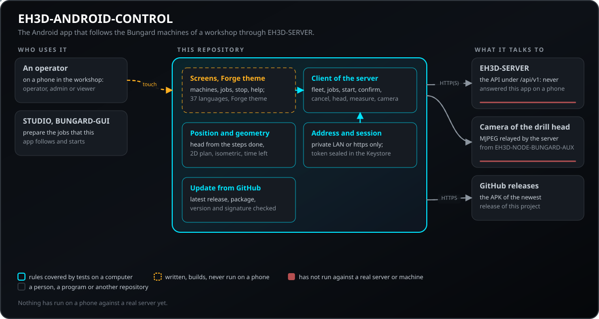
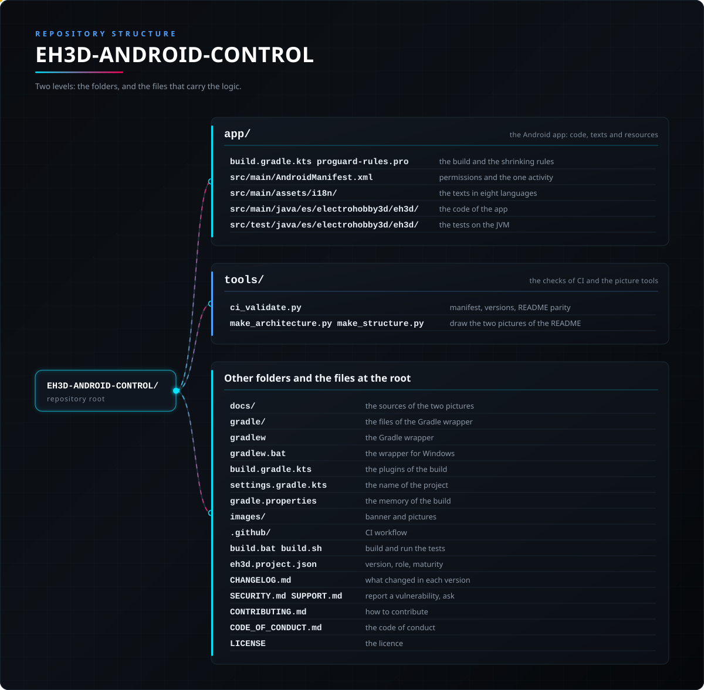

<p align="center">
  
</p>

# 🤖 EH3D-ANDROID-CONTROL

<p align="center">🇺🇸 <b>English</b> | <a href="README_spa.md">🇪🇸 Español</a> | <a href="README_fra.md">🇫🇷 Français</a> | <a href="README_ita.md">🇮🇹 Italiano</a> | <a href="README_deu.md">🇩🇪 Deutsch</a> | <a href="README_zho.md">🇨🇳 中文</a> | <a href="README_jpn.md">🇯🇵 日本語</a> | <a href="README_por.md">🇵🇹 Português</a></p>

### The Android app of the EH3D programs: it follows the Bungard machines of the workshop in real time through EH3D-SERVER, stops them, shows the job in 2D and 3D and shows the camera of the drill head

<p align="center">
  
  
  
  
  
</p>

---

**Honesty check - what actually runs today:** the rules of the app (reading what EH3D-SERVER says about the machines, jobs and drill head, the position of the head from the steps done, the 2D and isometric geometry, the languages, the address checks and the keeping of the session) are written and tested on a computer. The screens are written for Android in the Forge theme of the EH3D programs, but **the app has not been run on a phone against a real server**, the emergency stop has never stopped a real machine and the camera has never shown a real board.

---

> **Safety and security status:** this app is not a safety system and does not replace the emergency stop of the machine. Its stop cancels the running job through the server, which stops the machine and switches the drivers off; it needs the network and the server to be working. Only operators and administrators can stop or start; the password is sent only to a local-network address or over https, and a session is kept sealed on the phone.


## 📋 At a glance

| | |
|---|---|
| Version | `0.0.7` |
| Maturity | Scaffolding |
| Tests | unit tests on the JVM |
| Stack | Kotlin, Jetpack Compose |
| On real hardware | Not yet: the app has not been run on a phone, against a real server or with a machine; the first thing to try is signing in to the EH3D-SERVER of the workshop. |

**Jump to:** [Overview](#-overview) · [Architecture](#-architecture) · [Quick start](#-quick-start) · [Testing](#-testing) · [Structure](#-repository-structure) · [Related](#-related-projects)

## 🚦 Project status

Each line is one part of this repository and the light says how far it is today. It is written from what the repository can show (tests, builds, runs), not from what is planned.

🟢 Done and verified · 🟡 Works, with known limits · 🟠 Partly done or not verified yet · 🔴 Not done or not working

| Area | State | What it means here |
|---|---|---|
| Software | 🟠 | The screens and the rules of the app are written for Android; the rules build and are tested without a phone. |
| Tests | 🟡 | unit tests on the JVM: what the server says about the fleet, the jobs and the head, the position of the head, the 2D and isometric geometry, the languages and the address and version checks. |
| Monitoring | 🟠 | Each machine of the workshop with its state, its job, the progress, the steps done and the time left, read from the server every second and a half; a notice when a machine waits for the operator or stops. Written, not run against a real server. |
| Emergency stop | 🟠 | A red button that asks twice and cancels the running job through the server (one machine, or all of them); the confirmation of the steps a job waits for. Only operators and administrators. It has never stopped a real machine and does not replace its physical stop. |
| Preparing jobs | 🟠 | Choose drilling, routing, both or a G-code program and the file from the phone; the tools of the file with their count (and diameter when the file declares it), tools switched off, start at one tool; pause, resume, cancel and continue a stopped job (any kind) from where it stopped, with the file kept by the server; read the switch of the `$` lines of GRBL of the machine. The server has no list of files, so the file is sent from the phone. Written, never run against a real server or machine. |
| 2D and 3D viewer | 🟠 | The board, the holes (a ring until drilled), the paths (dim until cut) and the head, in 2D and in an isometric view that turns with a finger; the place of the head is an estimate from the steps done. Tested as geometry, never seen on a phone. |
| Camera of the head | 🟠 | The camera of the drill head (EH3D-NODE-BUNGARD-AUX) as MJPEG through the server, its turns, temperature and protect output, and one measure of the table with the laser. Written, never run with a real node. |
| Updates | 🟠 | It looks at the newest release of this project on GitHub, downloads the APK, checks the package, the version and the signature, and hands it to Android's installer; it never installs by itself. Written and tested; never run against GitHub from a phone. |
| Real use | 🔴 | Not yet: the app has not been run on a phone, against a real server or with a machine; the first thing to try is signing in to the EH3D-SERVER of the workshop. |
| Documentation | 🟡 | README in eight languages, the help of the app in eight languages and the notes of the server API it uses. |

## 🎯 Overview

* Each machine of the workshop with its state, its job, the progress, the steps done and the time left, read from the server every second and a half; a notice when a machine waits for the operator or stops. Written, not run against a real server.
* A red button that asks twice and cancels the running job through the server (one machine, or all of them); the confirmation of the steps a job waits for. Only operators and administrators. It has never stopped a real machine and does not replace its physical stop.
* Starting a job from its page asks once more (check that the machine is prepared and clear), as it does from Prepare, so a touch by mistake does not set the machine going.
* Choose drilling, routing, both or a G-code program and the file from the phone; the tools of the file with their count (and diameter when the file declares it), tools switched off, start at one tool; pause, resume, cancel and continue a stopped job (any kind) from where it stopped, with the file kept by the server; read the switch of the `$` lines of GRBL of the machine. The server has no list of files, so the file is sent from the phone. Written, never run against a real server or machine.
* The board, the holes (a ring until drilled), the paths (dim until cut) and the head, in 2D and in an isometric view that turns with a finger; the place of the head is an estimate from the steps done. Tested as geometry, never seen on a phone.
* The camera of the drill head (EH3D-NODE-BUNGARD-AUX) as MJPEG through the server, its turns, temperature and protect output, and one measure of the table with the laser. Written, never run with a real node.
* It looks at the newest release of this project on GitHub, downloads the APK, checks the package, the version and the signature, and hands it to Android's installer; it never installs by itself. Written and tested; never run against GitHub from a phone.

The page of a machine also has the ring of LEDs of the head (off and three levels) and a Quality check card: it asks the server to look at the board with the camera of the drill head, judges the holes and the milled channels and shows the verdict as big as a sign (OK, NOT OK or cannot judge) with what was found, the profile (standard, fine pitch, prototype) and the calibration of the scale. The first screens (the splash with the mark, the wait while the session is restored and the sign-in with its icons, the eye for the password and the note on what is kept on the phone) follow the look of the other apps of the suite.

The page of a machine also shows the spindle of the machine (the original one or the one with a variable-frequency drive), with its limits and the top speed the node should be set to; an administrator chooses it and chooses what the server does with a job that asks for more (refuse it, or let it through cut down to the top of the spindle). A job lists the excesses it was let through with, the tools that were switched off for it and the holes or paths already done that it leaves out. The page of a free machine also has Prepare job: choose what is done (drilling, routing, both or a free G-code program) and the file from the phone; the server plans it, and the app lists the tools of the file with their count, lets you switch tools off or start at one (the ones before it in the order of the job are left out) and starts the job after a confirmation. With both, two jobs are created and the second stays ready. A G-code program can be paused, resumed, cancelled and continued from the line where it stopped; the spindle and the coolant are started again only if you turn that option on (off by default).

The card of the drill head also shows what its sensors say: how the last reading of the laser went (valid, weak signal, too much spread, out of range, sensor fault) with the distance, how long ago it was taken and the offset the laser was calibrated with; whether the pulses of the speed sensor are clean or noisy and how many were refused as noise; how many temperature sensors the node found on the wire (and a warning when it is only guessing which one to read); and the version of the node. A node that does not say shows nothing of this. The settings of the image of the camera, the calibration of the laser and the choice of the temperature sensor are made in the panel of the node: the server does not hand them on yet.

## 🧩 Role in EH3D

EH3D-ANDROID-CONTROL is the pocket screen of the EH3D workshop: it talks only to EH3D-SERVER, which runs the jobs on the machines (through EH3D-NODE-BUNGARD) and relays the camera of the drill head (EH3D-NODE-BUNGARD-AUX). Jobs are prepared in EH3D-STUDIO or BUNGARD-GUI, or in this app with Prepare job; this app follows them, confirms the steps they wait for and stops them.

## 🏛️ Architecture

<p align="center">
  
</p>

How the parts of this repository fit together: who uses it, what it holds and what it depends on. The picture is drawn from `docs/architecture.json` and checked against the code.

## 🖼️ Screenshots

<p align="center">
  
</p>

<p align="center"><em>The machines of the workshop: free, working and waiting for the operator, with the stop of all of them.</em></p>

<p align="center">
  
</p>

<p align="center"><em>One machine: the stop, the job in progress and the live 2D view with the place of the head.</em></p>

<p align="center">
  
</p>

<p align="center"><em>The isometric view of the same job, turned with a finger, and its tools.</em></p>

<p align="center">
  
</p>

<p align="center"><em>The drill head: the camera through the server, the turns, the temperature, the protect output and the measure of the table.</em></p>

<p align="center">
  
</p>

<p align="center"><em>The jobs of the server with their states.</em></p>

<p align="center">
  
</p>

<p align="center"><em>More: the session, the update from GitHub, the language and the help.</em></p>

<p align="center"><em>A drawing of the screens made with the same rules and a sample job, not a capture from a phone: the app has not been run on one.</em></p>

## 🚀 Quick start

You need JDK 21 and the Android SDK (the Gradle wrapper does the rest), and an EH3D-SERVER on the network.

```bash
build.bat          # tests and debug APK (Windows)  -  ./build.sh on Linux
test.bat           # only the tests
python -I tools/ci_validate.py
```

Open the app, type the address of the server (and port 18200), press Connect and sign in. A server with no users asks for the set-up code it shows on its console and makes the first administrator.

## 🧪 Testing

`./gradlew test` runs the unit tests on the JVM: the readers of the server's JSON (fleet, jobs, head, measure), the position of the head and the geometry of the two views, the check of the address, the sealed keeping of the session, the version and the release gate of the update, and the languages (every phrase of the source in the seven tables, with the same holes). They also read the examples of the answers that the tests of the server make, so an answer that changes without the app following fails here.

## 🏗️ Build & Release

The version lives in `eh3d.project.json` and in `app/build.gradle.kts` (the build stops when they differ), and each version has its entry in [CHANGELOG.md](CHANGELOG.md). The release APK is shrunk with R8 and signed afterwards with the maintainer's own key, kept outside the repository; the asset of a release is `EH3D-ANDROID-CONTROL-release.apk`, the file that the update from GitHub looks for.

## 📂 Repository Structure

<p align="center">
  
</p>

<details>
<summary>Text version of the tree</summary>

```text
EH3D-ANDROID-CONTROL/
├── app/
│   ├── build.gradle.kts proguard-rules.pro      the build and the shrinking rules
│   ├── src/main/AndroidManifest.xml             permissions and the one activity
│   ├── src/main/assets/i18n/                    the texts in eight languages
│   ├── src/main/java/es/electrohobby3d/eh3d/    the code of the app
│   └── src/test/java/es/electrohobby3d/eh3d/    the tests on the JVM
├── tools/
│   ├── ci_validate.py                           manifest, versions, README parity
│   └── make_architecture.py make_structure.py   draw the two pictures of the README
├── docs/                                        the sources of the two pictures
├── gradle/                                      the files of the Gradle wrapper
├── gradlew                                      the Gradle wrapper
├── gradlew.bat                                  the wrapper for Windows
├── build.gradle.kts                             the plugins of the build
├── settings.gradle.kts                          the name of the project
├── gradle.properties                            the memory of the build
├── images/                                      banner and pictures
├── .github/                                     CI workflow
├── build.bat build.sh                           build and run the tests
├── eh3d.project.json                            version, role, maturity
├── CHANGELOG.md                                 what changed in each version
├── SECURITY.md SUPPORT.md                       report a vulnerability, ask
├── CONTRIBUTING.md                              how to contribute
├── CODE_OF_CONDUCT.md                           the code of conduct
└── LICENSE                                      the licence
```

</details>

## 🗺️ Roadmap & Known limits

**Known limits today**

* The app has not been run on a phone, against a real server or with a machine.
* The position of the head is an estimate from the steps done; the server does not report the real position of the machine.
* The emergency stop goes through the server and the network: it is not a physical stop.
* The camera has never shown a real image and the measure of the table has never been taken with a real laser.

**Next**

* Sign in to the EH3D-SERVER of the workshop and follow a real job.
* Show the true position of the head when the server reports it.
* Notices when the app is closed come from a periodic job (every 15 minutes at best, the least Android allows), not in real time; a push channel of the server would make them immediate and does not exist yet.
* Choose the file from the files kept on the server instead of the phone (the server has no list of files yet).

## 🌍 Languages

README and texts exist in English, Spanish, French, Italian, German, Chinese, Japanese and European Portuguese.

## 🔗 Related Projects

* [EH3D-SERVER](https://github.com/JuanenRac/EH3D-SERVER): the center of the EH3D family: it runs the jobs on the machines and gives this app everything it shows
* [EH3D-STUDIO](https://github.com/JuanenRac/EH3D-STUDIO): the pages where the machines are added and the jobs are prepared
* [EH3D-BUNGARD-GUI](https://github.com/JuanenRac/EH3D-BUNGARD-GUI): the program on the computer that prepares drilling and routing jobs and runs them
* [EH3D-NODE-BUNGARD-AUX](https://github.com/JuanenRac/EH3D-NODE-BUNGARD-AUX): the node of the drill head: the camera, the laser and the sensors this app shows
* [EH3D-IOS-CONTROL](https://github.com/JuanenRac/EH3D-IOS-CONTROL): the Android and the iPhone apps are twins: the same rules and the same screens

## 📚 Documentation

* [The API of the server](https://github.com/JuanenRac/EH3D-SERVER/blob/main/docs/API.md): what this app reads and asks.
* [Changelog](CHANGELOG.md)

## 🤝 Contributing & Community

* Before a pull request run `./gradlew test` and `python -I tools/ci_validate.py`: both must pass. See [CONTRIBUTING.md](CONTRIBUTING.md) and the [code of conduct](CODE_OF_CONDUCT.md).
* Every text the app shows is in the tables of `app/src/main/assets/i18n` in all eight languages; a test keeps them complete.
* Report a vulnerability privately: [SECURITY.md](SECURITY.md). Questions, ideas and reports: electrohobby3d@gmail.com ([SUPPORT.md](SUPPORT.md)).

## 👤 AUTHOR

**JuanenRac (Electro Hobby 3D)** · electrohobby3d@gmail.com

## 📜 LICENSE

Software: GPL-3.0-or-later. See [LICENSE](LICENSE). Hardware designs of the suite use CERN OHL-S.
