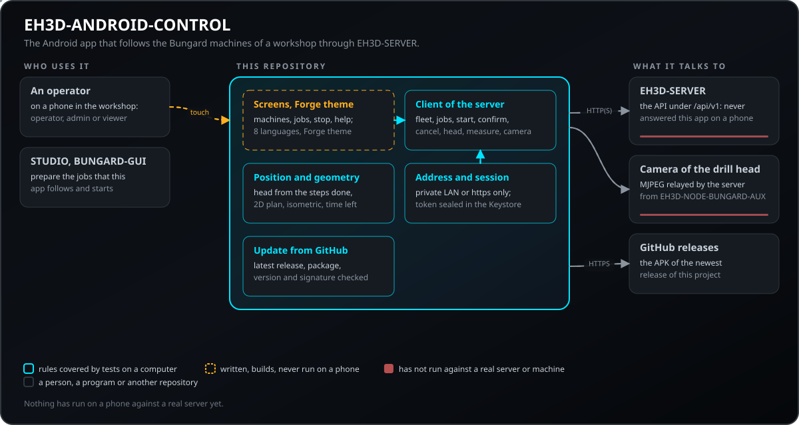
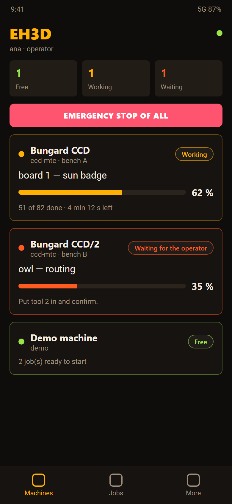
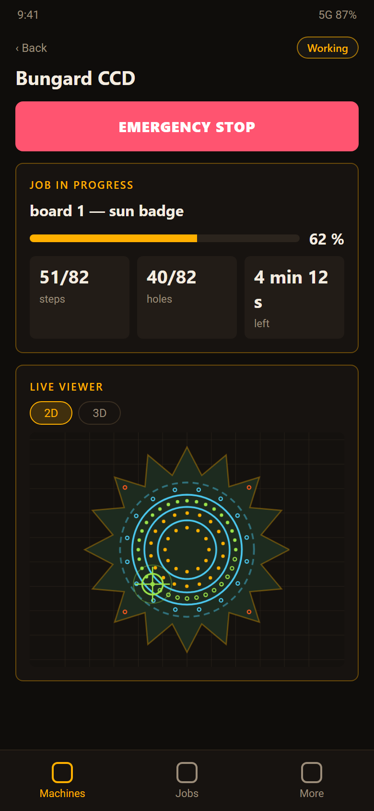
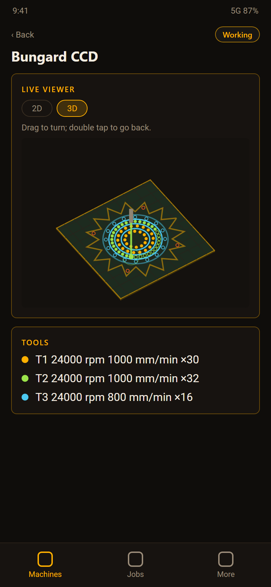
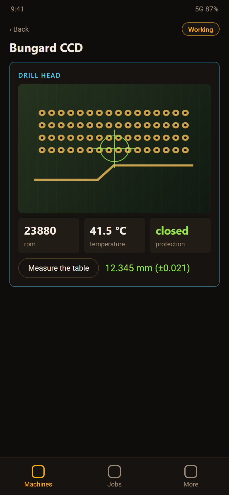
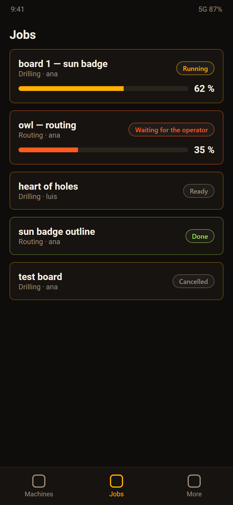
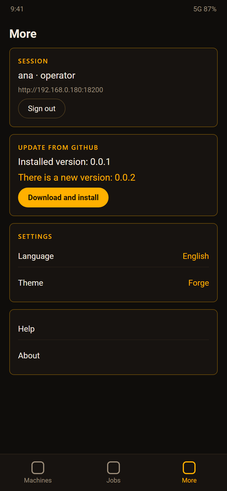
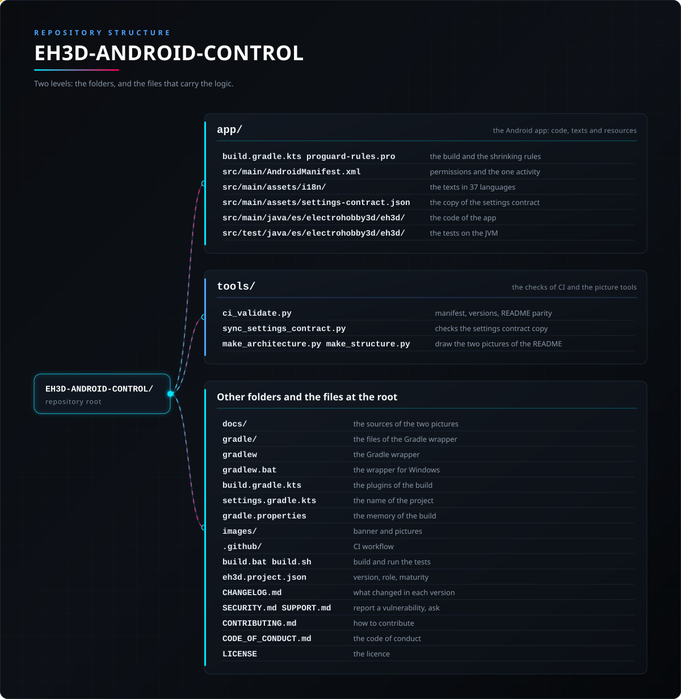

<p align="center">
  
</p>

# 🤖 EH3D-ANDROID-CONTROL

<p align="center"><a href="README.md">🇺🇸 English</a> | <a href="README_spa.md">🇪🇸 Español</a> | <a href="README_fra.md">🇫🇷 Français</a> | <a href="README_ita.md">🇮🇹 Italiano</a> | 🇩🇪 <b>Deutsch</b> | <a href="README_zho.md">🇨🇳 中文</a> | <a href="README_jpn.md">🇯🇵 日本語</a> | <a href="README_por.md">🇵🇹 Português</a></p>

### Die Android-App der EH3D-Programme: Sie verfolgt die Bungard-Maschinen der Werkstatt in Echtzeit über EH3D-SERVER, hält sie an, zeigt den Auftrag in 2D und 3D und die Kamera des Bohrkopfes

<p align="center">
  
  
  
  
  
</p>

---

**Ehrlichkeits-Check - was heute wirklich läuft:** Die Regeln der App (lesen, was EH3D-SERVER über Maschinen, Aufträge und Bohrkopf sagt, die Position des Kopfes aus den erledigten Schritten, die 2D- und isometrische Geometrie, die Sprachen, die Adressprüfungen und das Behalten der Sitzung) sind geschrieben und auf einem Computer getestet. Die Bildschirme sind für Android im Forge-Design der EH3D-Programme geschrieben, aber **die App wurde auf einem Telefon nie gegen einen echten Server ausgeführt**, der Not-Halt hat nie eine echte Maschine angehalten und die Kamera nie eine echte Platine gezeigt.

---

> **Sicherheitsstatus:** Diese App ist kein Sicherheitssystem und ersetzt nicht den Not-Halt der Maschine. Ihr Stopp bricht den laufenden Auftrag über den Server ab, der die Maschine anhält und die Antriebe abschaltet; Netz und Server müssen funktionieren. Nur Bediener und Administratoren können stoppen oder starten; das Passwort wird nur an eine Adresse im lokalen Netz oder über https gesendet, und die Sitzung wird verschlüsselt auf dem Telefon gehalten.


## 📋 Auf einen Blick

| | |
|---|---|
| Version | `0.1.9` |
| Reifegrad | Gerüst |
| Tests | 490 Unit-Tests auf der JVM |
| Technologie-Stack | Kotlin, Jetpack Compose |
| Auf echter Hardware | Noch nicht: Die App wurde nicht auf einem Telefon, gegen einen echten Server oder mit einer Maschine ausgeführt; als Erstes ist die Anmeldung am EH3D-SERVER der Werkstatt zu versuchen. |

**Springe zu:** [Überblick](#-überblick) · [Architektur](#-architektur) · [Schnellstart](#-schnellstart) · [Tests](#-tests) · [Struktur](#-struktur-des-repositorys) · [Verwandte](#-verwandte-projekte)

## 🚦 Projektstatus

Jede Zeile ist ein Teil dieses Repositorys, und die Ampel sagt, wie weit er heute ist. Sie beruht auf dem, was das Repository zeigen kann (Tests, Builds, Läufe), nicht auf dem, was geplant ist.

🟢 Fertig und überprüft · 🟡 Funktioniert, mit bekannten Grenzen · 🟠 Teilweise fertig oder noch nicht überprüft · 🔴 Nicht gemacht oder funktioniert nicht

| Bereich | Stand | Was das hier bedeutet |
|---|---|---|
| Software | 🟠 | Die Bildschirme und die Regeln der App sind für Android geschrieben; die Regeln werden ohne Telefon gebaut und getestet. |
| Tests | 🟡 | Unit-Tests auf der JVM: was der Server über Flotte, Aufträge und Kopf sagt, die Position des Kopfes, die 2D- und isometrische Geometrie, die Sprachen und die Adress- und Versionsprüfungen. |
| Überwachung | 🟠 | Jede Maschine der Werkstatt mit Zustand, Auftrag, Fortschritt, erledigten Schritten und Restzeit, alle anderthalb Sekunden vom Server gelesen; eine Meldung, wenn eine Maschine auf den Bediener wartet oder stoppt. Geschrieben, nicht gegen einen echten Server ausgeführt. |
| Verbindung | 🟠 | Die Anmeldung wird im letzten Viertel ihrer Laufzeit von selbst erneuert, die offenen Anmeldungen lassen sich auflisten und schließen, die Ablehnungen des Servers werden in acht Sprachen mit derselben Tabelle wie in Studio gemeldet, und Zeitlimit, Wiederholungen und eine optionale Suche nach dem Server im lokalen Netz (standardmäßig aus) sind Einstellungen. Geschrieben und gegen einen simulierten Server getestet; nicht gegen einen echten Server oder auf einem Telefon ausgeführt. |
| Not-Halt | 🟠 | Ein roter Knopf, der zweimal fragt und den laufenden Auftrag über den Server abbricht (eine Maschine oder alle); die Bestätigung der Schritte, auf die ein Auftrag wartet. Nur Bediener und Administratoren. Er hat nie eine echte Maschine angehalten und ersetzt nicht deren physischen Stopp. |
| Aufträge vorbereiten | 🟠 | Bohren, Fräsen, beides oder ein G-Code-Programm und die Datei vom Telefon wählen; die Werkzeuge der Datei mit Anzahl (und Durchmesser, wenn die Datei ihn angibt), Werkzeuge abschalten, bei einem Werkzeug beginnen; ein G-Code-Programm pausieren, fortsetzen, abbrechen und einen angehaltenen Auftrag (jeder Art) dort fortsetzen, wo er angehalten wurde, mit der vom Server gespeicherten Datei; den Schalter für die `$`-Zeilen von GRBL der Maschine lesen. Der Server hat keine Dateiliste, deshalb wird die Datei vom Telefon gesendet. Geschrieben, nie gegen einen echten Server oder eine echte Maschine gelaufen. |
| 2D- und 3D-Ansicht | 🟠 | Platine, Löcher (ein Ring bis zum Bohren), Bahnen (blass bis zum Fräsen) und Kopf, in 2D und in einer isometrischen Ansicht, die sich mit dem Finger dreht; die Position des Kopfes ist eine Schätzung aus den erledigten Schritten. Als Geometrie getestet, nie auf einem Telefon gesehen. |
| Kamera des Kopfes | 🟠 | Die Kamera des Bohrkopfes (EH3D-NODE-BUNGARD-AUX) als MJPEG über den Server, ihre Drehzahl, Temperatur und der Schutzausgang sowie eine Tischmessung mit dem Laser. Geschrieben, nie mit einem echten Knoten ausgeführt. |
| Updates | 🟠 | Sie sucht die neueste Release dieses Projekts auf GitHub, lädt die APK, prüft Paket, Version und Signatur und übergibt sie dem Android-Installer; sie installiert nie von selbst. Geschrieben und getestet; nie von einem Telefon gegen GitHub ausgeführt. |
| Maschinen der Plugins | 🟠 | Die Startseite listet die Laser-, Bestückungs-, Platinen-, CNC-, Gerber-, CAM-, 3D-Drucker-, Vision- und CAD-Maschinen des Servers mit einem Abzeichen NUR SIMULATOR (nichts wird als auf Hardware bewährt gezeigt), ihre Verriegelungen in Rot, einen Not-Halt mit einer Berührung und ohne Rückfrage, das Lösen einer Verriegelung nur für Administratoren (zweimal bestätigt), die Warteschlange jeder Maschine (jeder Auftrag zeigt einen kurzen Code seines Hashs mit einem Abzeichen - nicht autorisiert, autorisiert oder abgelaufen; eine Person autorisiert ihn mit einer zweiten Berührung und startet ihn, zweimal bestätigt, mit dem angezeigten Code; nie von selbst), die Temperaturgrenzen eines Druckers und für Administratoren die Schalter des Servers, die standardmäßig aus sind. Geschrieben und gegen einen simulierten Server getestet; nie auf einem Telefon oder mit einer echten Maschine gelaufen. |
| Einstellungen des Servers | 🟠 | Eine Seite unter Mehr zeichnet jede Einstellung und jeden Schalter des Servers aus seinem Vertrag (107 Schlüssel in 17 Gruppen; vom Server gelesen und, wenn das nicht geht, aus der in der App gespeicherten Kopie, nur lesbar): Bezeichnung, Hilfe und Warnung in acht Sprachen, den gültigen Wert, den Standardwert mit einer Schaltfläche zum Wiederherstellen, ob eine Änderung sofort wirkt oder einen Neustart braucht, und das Bedienelement seines Typs. Jeder andere Zugang (Betrachter, Bediener) liest die leichte Ansicht der gültigen Werte (`GET /settings/values`, mit ETag, damit eine unveränderte Seite nur wenige Bytes kostet) mit den Bezeichnungen der Kopie, nur lesbar, und wird gewarnt, wenn die Einstellungsliste des Servers nicht die Kopie der App ist; ein Schlüssel, den der Server nicht zeigt, wird als solcher markiert. Ein Administrator ändert die 19 Schlüssel, die der Server im Betrieb ändert, und wird bei riskanten ein zweites Mal gefragt; die übrigen 81 werden mit dem Hinweis angezeigt, dass sie in server.cfg gesetzt werden; ein Geheimnis wird nie angezeigt. Geschrieben und gegen einen simulierten Server getestet; nie gegen einen echten gelaufen. |
| Pick-and-Place-Knoten | 🟠 | Die Startseite listet die Zuführungs- und Kopfknoten der Pick-and-Place-Maschinen, die der Server führt, nur lesend auf: Art, Adresse und Maschine, bereit (grün) oder nicht (rot), wie der Server es zählt, den gemeldeten Zustand, den letzten Fehler der Abfrage und die zuletzt gemeldeten Zahlen; das Token wird nie gelesen oder angezeigt, und die Knoten werden in EH3D-STUDIO eingetragen und geändert. Geschrieben und gegen einen simulierten Server getestet; nie mit einer echten Zuführung, einem echten Kopf oder Server ausgeführt. |
| 3D-Drucker | 🟠 | Die Startseite listet, nur lesend, die 3D-Drucker auf, die der Server beobachtet: Erreichbarkeit, Zustand, Temperaturen, Fortschritt, Restzeit, Schicht und Meldungen; was ein Drucker nicht gesagt hat, wird als unbekannt gezeigt, nie als null, solange die Liste auf dem Server ausgeschaltet ist, wird nichts gezeigt, und an einen Drucker kann nichts gesendet werden (der Zugangscode wird nie gelesen). Geschrieben und gegen simulierte Antworten getestet; nie mit einem echten Drucker, Server oder Telefon ausgeführt. |
| Echter Einsatz | 🔴 | Noch nicht: Die App wurde nicht auf einem Telefon, gegen einen echten Server oder mit einer Maschine ausgeführt; als Erstes ist die Anmeldung am EH3D-SERVER der Werkstatt zu versuchen. |
| Dokumentation | 🟡 | README in acht Sprachen, die Hilfe der App in 8 Sprachen und die Hinweise zur verwendeten Server-API. |

## 🎯 Überblick

* Jede Maschine der Werkstatt mit Zustand, Auftrag, Fortschritt, erledigten Schritten und Restzeit, alle anderthalb Sekunden vom Server gelesen; eine Meldung, wenn eine Maschine auf den Bediener wartet oder stoppt. Geschrieben, nicht gegen einen echten Server ausgeführt.
* Ein roter Knopf, der zweimal fragt und den laufenden Auftrag über den Server abbricht (eine Maschine oder alle); die Bestätigung der Schritte, auf die ein Auftrag wartet. Nur Bediener und Administratoren. Er hat nie eine echte Maschine angehalten und ersetzt nicht deren physischen Stopp.
* Das Starten eines Auftrags von seiner Seite aus fragt noch einmal nach (prüfen, ob die Maschine bereit und frei ist), wie von Vorbereiten aus, damit eine versehentliche Berührung die Maschine nicht in Gang setzt.
* Vor dem Start eines Auftrags zeigt eine Zusammenfassung, was er tut, wie lange er dauert, wie weit jede Achse fährt (der Trockenlauf des genauen Plans, den der Server gemacht hat) und was falsch aussieht, mit Starten und Abbrechen; eine Einstellung schaltet sie ab (standardmäßig an). Geschrieben, nie mit einem echten Server ausgeführt.
* Die Verbindung wird ehrlich gemeldet: verbunden, alternde Daten (mit ihrem Alter), keine Verbindung nach zwei Fehlern in Folge oder eine Adresse, unter der ein anderer Dienst antwortet, mit einer Taste zum erneuten Versuch; beim Drücken von ANHALTEN ohne Verbindung warnt die App, dass der Befehl nicht ankommen könnte und der physische Stopp der Maschine zu benutzen ist, und nach einem Stopp sagt sie, ob die Maschine ihn bestätigt hat. Geschrieben, nie mit einem echten Server ausgeführt.
* Bohren, Fräsen, beides oder ein G-Code-Programm und die Datei vom Telefon wählen; die Werkzeuge der Datei mit Anzahl (und Durchmesser, wenn die Datei ihn angibt), Werkzeuge abschalten, bei einem Werkzeug beginnen; ein G-Code-Programm pausieren, fortsetzen, abbrechen und einen angehaltenen Auftrag (jeder Art) dort fortsetzen, wo er angehalten wurde, mit der vom Server gespeicherten Datei; den Schalter für die `$`-Zeilen von GRBL der Maschine lesen. Der Server hat keine Dateiliste, deshalb wird die Datei vom Telefon gesendet. Geschrieben, nie gegen einen echten Server oder eine echte Maschine gelaufen.
* Platine, Löcher (ein Ring bis zum Bohren), Bahnen (blass bis zum Fräsen) und Kopf, in 2D und in einer isometrischen Ansicht, die sich mit dem Finger dreht; die Position des Kopfes ist eine Schätzung aus den erledigten Schritten. Als Geometrie getestet, nie auf einem Telefon gesehen.
* Die Kamera des Bohrkopfes (EH3D-NODE-BUNGARD-AUX) als MJPEG über den Server, ihre Drehzahl, Temperatur und der Schutzausgang sowie eine Tischmessung mit dem Laser. Geschrieben, nie mit einem echten Knoten ausgeführt.
* Sie sucht die neueste Release dieses Projekts auf GitHub, lädt die APK, prüft Paket, Version und Signatur und übergibt sie dem Android-Installer; sie installiert nie von selbst. Geschrieben und getestet; nie von einem Telefon gegen GitHub ausgeführt.
* Eine Seite unter Mehr zeichnet jede Einstellung und jeden Schalter des Servers aus seinem Vertrag (107 Schlüssel in 17 Gruppen; vom Server gelesen und, wenn das nicht geht, aus der in der App gespeicherten Kopie, nur lesbar): Bezeichnung, Hilfe und Warnung in acht Sprachen, den gültigen Wert, den Standardwert mit einer Schaltfläche zum Wiederherstellen, ob eine Änderung sofort wirkt oder einen Neustart braucht, und das Bedienelement seines Typs. Ein Administrator ändert die 19 Schlüssel, die der Server im Betrieb ändert, und wird bei riskanten ein zweites Mal gefragt; die übrigen 81 werden mit dem Hinweis angezeigt, dass sie in server.cfg gesetzt werden; ein Geheimnis wird nie angezeigt. Geschrieben und gegen einen simulierten Server getestet; nie gegen einen echten gelaufen.
* Die Startseite listet die Zuführungs- und Kopfknoten der Pick-and-Place-Maschinen, die der Server führt, nur lesend auf: Art, Adresse und Maschine, bereit (grün) oder nicht (rot), wie der Server es zählt, den gemeldeten Zustand, den letzten Fehler der Abfrage und die zuletzt gemeldeten Zahlen; das Token wird nie gelesen oder angezeigt, und die Knoten werden in EH3D-STUDIO eingetragen und geändert. Geschrieben und gegen einen simulierten Server getestet; nie mit einer echten Zuführung, einem echten Kopf oder Server ausgeführt.
* Die Startseite listet, nur lesend, die 3D-Drucker auf, die der Server beobachtet: Erreichbarkeit, Zustand, Temperaturen, Fortschritt, Restzeit, Schicht und Meldungen; was ein Drucker nicht gesagt hat, wird als unbekannt gezeigt, nie als null, solange die Liste auf dem Server ausgeschaltet ist, wird nichts gezeigt, und an einen Drucker kann nichts gesendet werden (der Zugangscode wird nie gelesen). Geschrieben und gegen simulierte Antworten getestet; nie mit einem echten Drucker, Server oder Telefon ausgeführt.

Die Seite einer Maschine hat außerdem den LED-Ring des Kopfes (aus und drei Stufen) und eine Karte Qualitätsprüfung: Sie lässt den Server die Platine mit der Kamera des Bohrkopfes ansehen, beurteilt die Bohrungen und die gefrästen Kanäle und zeigt das Urteil so groß wie ein Schild (IN ORDNUNG, NICHT IN ORDNUNG oder nicht beurteilbar) mit den Befunden, dem Profil (Standard, Feinraster, Prototyp) und der Kalibrierung des Maßstabs. Die ersten Bildschirme (der Startbildschirm mit dem Zeichen, das Warten beim Wiederherstellen der Sitzung und die Anmeldung mit ihren Symbolen, dem Auge für das Passwort und dem Hinweis, was auf dem Telefon bleibt) folgen dem Aussehen der anderen Apps der Suite.

Die Seite einer Maschine zeigt außerdem die Spindel der Maschine (die originale oder die mit Frequenzumrichter), mit ihren Grenzen und der Höchstdrehzahl, auf die der Knoten eingestellt sein soll; ein Administrator wählt sie und wählt, was der Server mit einem Auftrag tut, der mehr verlangt (ablehnen oder auf das Maximum der Spindel gekürzt durchlassen). Ein Auftrag listet die Überschreitungen, mit denen er durchgelassen wurde, die für ihn abgeschalteten Werkzeuge und die schon erledigten Löcher oder Pfade, die er auslässt. Die Seite einer freien Maschine hat außerdem Auftrag vorbereiten: Man wählt, was gemacht wird (Bohren, Fräsen, beides oder ein freies G-Code-Programm), und die Datei vom Telefon; der Server plant sie, und die App listet die Werkzeuge der Datei mit ihrer Anzahl, lässt Werkzeuge abschalten oder bei einem beginnen (die davor liegenden in der Reihenfolge des Auftrags werden ausgelassen) und startet den Auftrag nach einer Bestätigung. Bei beidem entstehen zwei Aufträge, und der zweite bleibt bereit. Ein G-Code-Programm lässt sich pausieren, fortsetzen, abbrechen und ab der Zeile fortsetzen, an der es angehalten wurde; Spindel und Kühlmittel werden nur wieder eingeschaltet, wenn man diese Option aktiviert (standardmäßig aus).

Geht ein G-Code-Auftrag nach einem Halt weiter, sagt die App vor der Bestätigung, dass die Maschine selbst zur Haltestelle zurückfährt und die Spindel startet, wenn das Programm sie eingeschaltet hatte; der Schalter unter Vorbereiten gilt nur für das Kühlmittel. Setzt der Server einen angehaltenen Auftrag nicht selbst fort, behält die Seite des Auftrags den Grund.

Die Karte des Bohrkopfs zeigt außerdem, was seine Sensoren melden: wie die letzte Messung des Lasers verlief (gültig, schwaches Signal, zu große Streuung, außerhalb des Bereichs, Sensorfehler) mit der Entfernung, wie lange sie her ist und mit welchem Versatz der Laser kalibriert wurde; ob die Impulse des Drehzahlsensors sauber oder verrauscht sind und wie viele als Rauschen verworfen wurden; wie viele Temperatursensoren der Knoten am Draht gefunden hat (und eine Warnung, wenn er nur rät, welchen er lesen soll); und die Version des Knotens. Ein Knoten, der das nicht meldet, zeigt davon nichts. Die Einstellungen des Kamerabilds, die Kalibrierung des Lasers und die Wahl des Temperatursensors erfolgen im Panel des Knotens: Der Server reicht sie noch nicht weiter.

## 🧩 Rolle in EH3D

EH3D-ANDROID-CONTROL ist der Taschenbildschirm der EH3D-Werkstatt: Sie spricht nur mit EH3D-SERVER, der die Aufträge auf den Maschinen ausführt (über EH3D-NODE-BUNGARD) und die Kamera des Bohrkopfes (EH3D-NODE-BUNGARD-AUX) weiterreicht. Aufträge werden in EH3D-STUDIO, BUNGARD-GUI oder in dieser App mit Auftrag vorbereiten vorbereitet; diese App verfolgt sie, bestätigt die Schritte, auf die sie warten, und hält sie an.

## 🏛️ Architektur

<p align="center">
  
</p>

Wie die Teile dieses Repositorys zusammenpassen: wer es nutzt, was es enthält und wovon es abhängt. Das Bild wird aus `docs/architecture.json` gezeichnet und gegen den Code geprüft.

## 🖼️ Screenshots

<p align="center">
  
</p>

<p align="center"><em>Die Maschinen der Werkstatt: frei, arbeitend und auf den Bediener wartend, mit dem Stopp aller.</em></p>

<p align="center">
  
</p>

<p align="center"><em>Eine Maschine: der Stopp, der laufende Auftrag und die 2D-Live-Ansicht mit der Position des Kopfes.</em></p>

<p align="center">
  
</p>

<p align="center"><em>Die isometrische Ansicht desselben Auftrags, mit dem Finger gedreht, und seine Werkzeuge.</em></p>

<p align="center">
  
</p>

<p align="center"><em>Der Bohrkopf: die Kamera über den Server, Drehzahl, Temperatur, der Schutzausgang und die Tischmessung.</em></p>

<p align="center">
  
</p>

<p align="center"><em>Die Aufträge des Servers mit ihren Zuständen.</em></p>

<p align="center">
  
</p>

<p align="center"><em>Mehr: die Sitzung, das Update von GitHub, die Sprache und die Hilfe.</em></p>

<p align="center"><em>Eine Zeichnung der Bildschirme mit denselben Regeln und einem Beispielauftrag, keine Aufnahme von einem Telefon: Die App wurde auf keinem ausgeführt.</em></p>

## 🚀 Schnellstart

Sie brauchen JDK 21 und das Android-SDK (der Gradle-Wrapper erledigt den Rest) und einen EH3D-SERVER im Netz.

```bash
build.bat          # tests and debug APK (Windows)  -  ./build.sh on Linux
test.bat           # only the tests
python -I tools/ci_validate.py
```

App öffnen, die Adresse des Servers (und Port 18200) eingeben, Verbinden drücken und anmelden. Ein Server ohne Benutzer verlangt den Einrichtungscode von seiner Konsole und legt den ersten Administrator an.

## 🧪 Tests

`./gradlew test` führt die Unit-Tests auf der JVM aus: die Leser des Server-JSON (Flotte, Aufträge, Kopf, Messung), die Position des Kopfes und die Geometrie der beiden Ansichten, die Adressprüfung, die verschlüsselte Sitzungsspeicherung, die Version und das Release-Tor des Updates sowie die Sprachen (jeder Satz des Quelltexts in den sieben Tabellen, mit denselben Platzhaltern). Sie lesen auch die Beispiele der Antworten, die die Tests des Servers erzeugen; eine Antwort, die sich ändert, ohne dass die App folgt, schlägt hier fehl. Beide Handy-Apps durchlaufen außerdem dieselben Falldateien (die Zusammenfassung, die Verbindung, den Stopp, die Hinweise, die Adressen und die gelesenen Felder), sodass sich die eine nicht von der anderen unterscheiden kann, ohne dass ein Test fehlschlägt. `python -I tools/check_app_parity.py` prüft, dass die Beispiele der Antworten, der Katalog der Ablehnungen und die Tabellen der 8 Sprachen in beiden Handy-Apps gleich sind (der eine Satz des angehefteten Zertifikats ist der einzige erlaubte Unterschied), und die CI gibt aus, wie viel vom Code mit Regeln diese Tests abdecken. `python -I tools/sync_settings_contract.py --check` prüft, dass die Kopie des Einstellungsvertrags des Servers (und die Tabelle der Sätze seiner Seite) gültig ist und, wenn EH3D-SERVER neben diesem Repository liegt, dieselbe Datei wie die des Servers; `check_app_parity.py` prüft außerdem, dass beide Apps dieselbe Kopie und dieselbe Tabelle tragen. Dieselbe Prüfung schreibt den SHA-256 der Kopie nach `ContractHash.kt` und prüft ihn; die App vergleicht ihn mit dem `contract_hash` des Servers und kann so melden, wenn die Einstellungsliste des Servers nicht ihre Kopie ist. Simulierte und feindliche Antworten der Liste der 3D-Drucker (`printer_cases.json`, von beiden Apps geteilt) prüfen, dass Unbekanntes unbekannt bleibt, dass eine ausgeschaltete Liste nichts zeigt und dass die App keine Anfrage hat, die einem Drucker etwas senden könnte. Geprüft wird auch, dass ein Befehl, der eine Maschine bewegt, nur einmal gesendet wird, dass von veralteten Daten aus nichts startet, dass ein Befehl ohne Antwort als vielleicht angekommen gemeldet wird und dass ein verspäteter Plan verworfen wird.

## 🏗️ Build und Veröffentlichung

Die Version steht in `eh3d.project.json` und in `app/build.gradle.kts` (der Build bricht ab, wenn sie sich unterscheiden), und jede Version hat ihren Eintrag in [CHANGELOG.md](CHANGELOG.md). Die Release-APK wird mit R8 verkleinert und danach mit dem eigenen Schlüssel des Maintainers signiert, der außerhalb des Repositorys liegt; die Datei einer Release ist `EH3D-ANDROID-CONTROL-release.apk`, die das Update von GitHub sucht.

## 📂 Struktur des Repositorys

<p align="center">
  
</p>

<details>
<summary>Textversion des Baums</summary>

```text
EH3D-ANDROID-CONTROL/
├── app/
│   ├── build.gradle.kts proguard-rules.pro      der Build und die Verkleinerungsregeln
│   ├── src/main/AndroidManifest.xml             Berechtigungen und die eine Activity
│   ├── src/main/assets/i18n/                    die Texte in 8 Sprachen
│   ├── src/main/assets/settings-contract.json   die Kopie des Einstellungsvertrags
│   ├── src/main/java/es/electrohobby3d/eh3d/    der Code der App
│   └── src/test/java/es/electrohobby3d/eh3d/    die Tests auf der JVM
├── tools/
│   ├── ci_validate.py                           Manifest, Versionen, README-Parität
│   ├── sync_settings_contract.py                prüft die Vertragskopie
│   └── make_architecture.py make_structure.py   zeichnen die zwei Bilder des README
├── docs/                                        die Quellen der zwei Bilder
├── gradle/                                      die Dateien des Gradle-Wrappers
├── gradlew                                      der Gradle-Wrapper
├── gradlew.bat                                  der Wrapper für Windows
├── build.gradle.kts                             die Plugins des Builds
├── settings.gradle.kts                          der Name des Projekts
├── gradle.properties                            der Speicher des Builds
├── images/                                      Banner und Bilder
├── .github/                                     CI-Workflow
├── build.bat build.sh                           bauen und Tests ausführen
├── eh3d.project.json                            Version, Rolle, Reife
├── CHANGELOG.md                                 was sich in jeder Version geändert hat
├── SECURITY.md SUPPORT.md                       Schwachstelle melden, fragen
├── CONTRIBUTING.md                              wie man beiträgt
├── CODE_OF_CONDUCT.md                           der Verhaltenskodex
└── LICENSE                                      die Lizenz
```

</details>

## 🗺️ Roadmap und bekannte Grenzen

**Bekannte Grenzen heute**

* Die App wurde nicht auf einem Telefon, gegen einen echten Server oder mit einer Maschine ausgeführt.
* Die Position des Kopfes ist eine Schätzung aus den erledigten Schritten; der Server meldet nicht die echte Position der Maschine.
* Der Not-Halt läuft über Server und Netz: Er ist kein physischer Stopp.
* Die Kamera hat nie ein echtes Bild gezeigt, und die Tischmessung wurde nie mit einem echten Laser genommen.

**Als Nächstes**

* Sich am EH3D-SERVER der Werkstatt anmelden und einen echten Auftrag verfolgen.
* Die wahre Position des Kopfes zeigen, sobald der Server sie meldet.
* Hinweise bei geschlossener App kommen von einer periodischen Aufgabe (höchstens alle 15 Minuten, das Minimum, das Android erlaubt), nicht in Echtzeit; ein Push-Kanal des Servers würde sie sofort machen und existiert noch nicht.
* Die Datei aus den auf dem Server gespeicherten wählen statt vom Telefon (der Server hat noch keine Dateiliste).

## 🌍 Sprachen

Das README gibt es auf Englisch, Spanisch, Französisch, Italienisch, Deutsch, Chinesisch, Japanisch und europäischem Portugiesisch. Die App selbst spricht dieselben acht Sprachen (die der EH3D-Programme auf dem Computer); ein Satz, den eine Sprache nicht hat, erscheint auf Englisch.

| Code | Sprache | Code | Sprache | Code | Sprache | Code | Sprache |
|---|---|---|---|---|---|---|---|
| `en` | English | `es` | Español | `it` | Italiano | `de` | Deutsch |
| `fr` | Français | `pt` | Português | `zh` | 中文 | `ja` | 日本語 |

## 🔗 Verwandte Projekte

* [EH3D-SERVER](https://github.com/JuanenRac/EH3D-SERVER): das Zentrum der EH3D-Familie: Es führt die Aufträge auf den Maschinen aus und liefert dieser App alles, was sie zeigt
* [EH3D-STUDIO](https://github.com/JuanenRac/EH3D-STUDIO): die Seiten, auf denen Maschinen hinzugefügt und Aufträge vorbereitet werden
* [EH3D-BUNGARD-GUI](https://github.com/JuanenRac/EH3D-BUNGARD-GUI): das Programm am Computer, das Bohr- und Fräsaufträge vorbereitet und ausführt
* [EH3D-NODE-BUNGARD-AUX](https://github.com/JuanenRac/EH3D-NODE-BUNGARD-AUX): der Knoten des Bohrkopfes: Kamera, Laser und Sensoren, die diese App zeigt
* [EH3D-IOS-CONTROL](https://github.com/JuanenRac/EH3D-IOS-CONTROL): die Android- und die iPhone-App sind Zwillinge: dieselben Regeln und dieselben Bildschirme

## 📚 Dokumentation

* [Die API des Servers](https://github.com/JuanenRac/EH3D-SERVER/blob/main/docs/API.md): was diese App liest und anfordert.
* [Unterschiede zwischen den Apps für Android und iPhone](docs/PLATFORM_DIFFERENCES.md): was das System erzwingt, anders zu sein.
* [Änderungsprotokoll](CHANGELOG.md)

## 🤝 Mitwirken und Community

* Vor einem Pull-Request `./gradlew test` und `python -I tools/ci_validate.py` ausführen: beide müssen bestehen. Siehe [CONTRIBUTING.md](CONTRIBUTING.md) und den [Verhaltenskodex](CODE_OF_CONDUCT.md).
* Jeder Text der App steht in den Tabellen unter `app/src/main/assets/i18n` in allen 8 Sprachen; ein Test hält sie vollständig.
* Eine Sicherheitslücke privat melden: [SECURITY.md](SECURITY.md). Fragen, Ideen und Meldungen: electrohobby3d@gmail.com ([SUPPORT.md](SUPPORT.md)).

## 👤 AUTOR

**JuanenRac (Electro Hobby 3D)** · electrohobby3d@gmail.com

## 📜 LIZENZ

Software: GPL-3.0-or-later. Siehe [LICENSE](LICENSE). Die Hardware-Entwürfe der Suite verwenden die CERN OHL-S.
