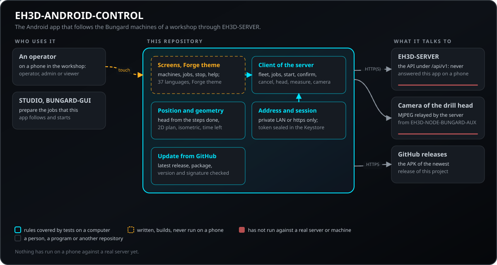
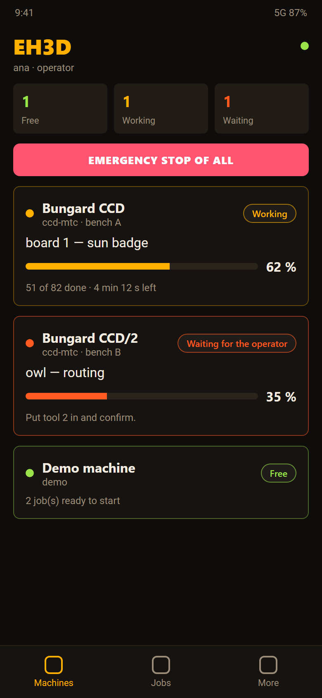
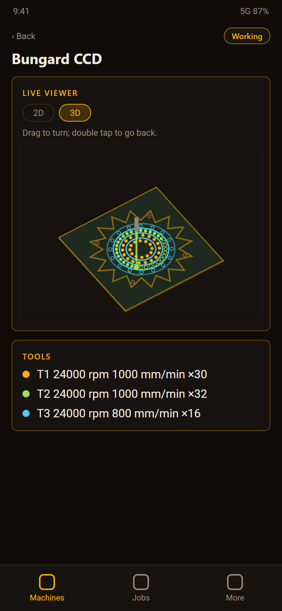
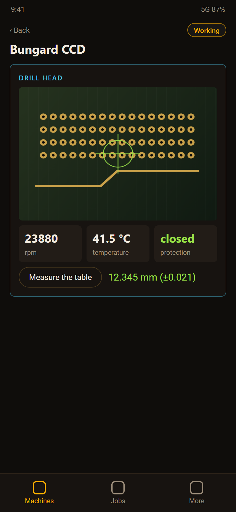
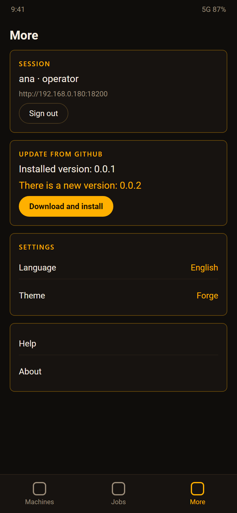
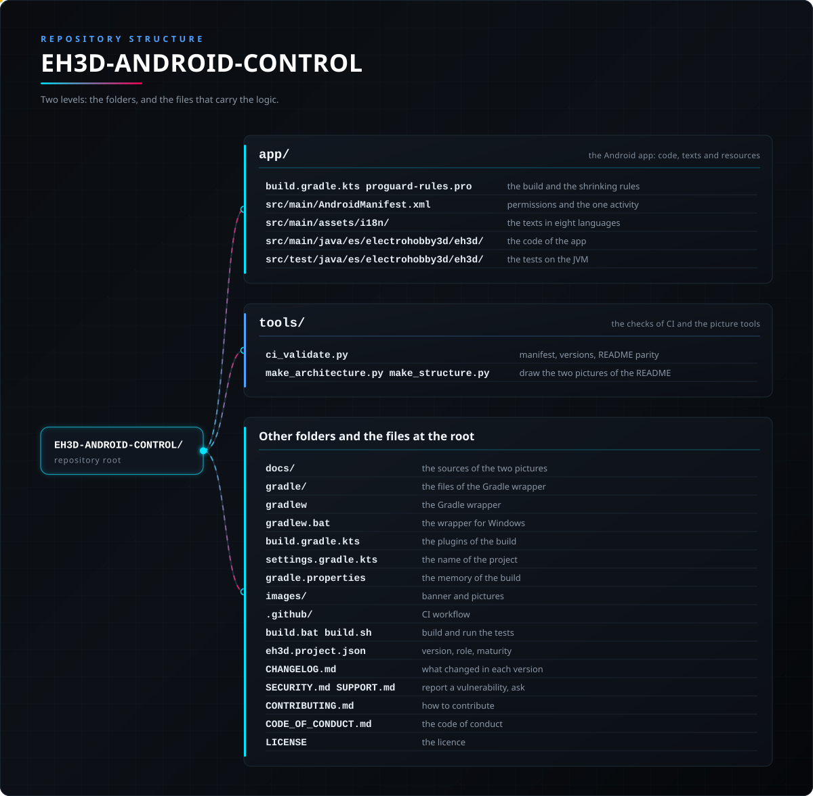

<p align="center">
  
</p>

# 🤖 EH3D-ANDROID-CONTROL

<p align="center"><a href="README.md">🇺🇸 English</a> | <a href="README_spa.md">🇪🇸 Español</a> | 🇫🇷 <b>Français</b> | <a href="README_ita.md">🇮🇹 Italiano</a> | <a href="README_deu.md">🇩🇪 Deutsch</a> | <a href="README_zho.md">🇨🇳 中文</a> | <a href="README_jpn.md">🇯🇵 日本語</a> | <a href="README_por.md">🇵🇹 Português</a></p>

### L'application Android des programmes EH3D : elle suit en temps réel les machines Bungard de l'atelier via EH3D-SERVER, les arrête, montre le travail en 2D et 3D et la caméra de la tête de perçage

<p align="center">
  
  
  
  
  
</p>

---

**Vérification d'honnêteté - ce qui tourne aujourd'hui :** les règles de l'application (lire ce que EH3D-SERVER dit des machines, des travaux et de la tête, la position de la tête à partir des étapes faites, la géométrie 2D et isométrique, les langues, les contrôles d'adresse et la conservation de la session) sont écrites et testées sur un ordinateur. Les écrans sont écrits pour Android dans le thème Forge des programmes EH3D, mais **l'application n'a pas été exécutée sur un téléphone contre un vrai serveur**, l'arrêt d'urgence n'a jamais arrêté une vraie machine et la caméra n'a jamais montré une vraie carte.

---

> **État de sécurité :** cette application n'est pas un système de sécurité et ne remplace pas l'arrêt d'urgence de la machine. Son arrêt annule le travail en cours via le serveur, qui arrête la machine et coupe les moteurs ; il faut que le réseau et le serveur fonctionnent. Seuls les opérateurs et les administrateurs peuvent arrêter ou démarrer ; le mot de passe n'est envoyé qu'à une adresse du réseau local ou en https, et la session est conservée chiffrée sur le téléphone.


## 📋 En un coup d'œil

| | |
|---|---|
| Version | `0.0.5` |
| Maturité | Échafaudage |
| Tests | tests unitaires sur la JVM |
| Pile technique | Kotlin, Jetpack Compose |
| Sur du matériel réel | Pas encore : l'application n'a pas été exécutée sur un téléphone, contre un vrai serveur ni avec une machine ; la première chose à essayer est de se connecter au EH3D-SERVER de l'atelier. |

**Aller à  :** [Présentation](#-présentation) · [Architecture](#-architecture) · [Démarrage rapide](#-démarrage-rapide) · [Tests](#-tests) · [Structure](#-structure-du-dépôt) · [Liés](#-projets-liés)

## 🚦 État du projet

Chaque ligne est une partie de ce dépôt et le feu dit où elle en est aujourd'hui. Elle est écrite d'après ce que le dépôt peut montrer (tests, compilations, exécutions), pas d'après ce qui est prévu.

🟢 Fait et vérifié · 🟡 Fonctionne, avec des limites connues · 🟠 À moitié fait ou pas encore vérifié · 🔴 Pas fait ou ne fonctionne pas

| Domaine | État | Ce que cela veut dire ici |
|---|---|---|
| Logiciel | 🟠 | Les écrans et les règles de l'application sont écrits pour Android ; les règles se compilent et se testent sans téléphone. |
| Tests | 🟡 | tests unitaires sur la JVM : ce que dit le serveur de la flotte, des travaux et de la tête, la position de la tête, la géométrie 2D et isométrique, les langues et les contrôles d'adresse et de version. |
| Surveillance | 🟠 | Chaque machine de l'atelier avec son état, son travail, la progression, les étapes faites et le temps restant, lu depuis le serveur toutes les secondes et demie ; un avis quand une machine attend l'opérateur ou s'arrête. Écrit, non exécuté contre un vrai serveur. |
| Arrêt d'urgence | 🟠 | Un bouton rouge qui demande deux fois et annule le travail en cours via le serveur (une machine ou toutes) ; la confirmation des étapes qu'attend un travail. Seulement opérateurs et administrateurs. Il n'a jamais arrêté une vraie machine et ne remplace pas son arrêt physique. |
| Préparer des travaux | 🟠 | Choisir perçage, fraisage, les deux ou un programme G-code et le fichier du téléphone ; les outils du fichier avec leur nombre (et leur diamètre quand le fichier le déclare), désactiver des outils, commencer par l'un d'eux ; mettre en pause, reprendre, annuler et reprendre un travail arrêté (de tout type) là où il s'est arrêté, avec le fichier gardé par le serveur ; lire l'interrupteur des lignes `$` de GRBL de la machine. Le serveur n'a pas de liste de fichiers : le fichier est envoyé depuis le téléphone. Écrit, jamais exécuté contre un vrai serveur ni une vraie machine. |
| Visionneuse 2D et 3D | 🟠 | La carte, les trous (un anneau jusqu'au perçage), les trajets (pâles jusqu'à la coupe) et la tête, en 2D et dans une vue isométrique qui tourne au doigt ; la position de la tête est une estimation à partir des étapes faites. Testé comme géométrie, jamais vu sur un téléphone. |
| Caméra de la tête | 🟠 | La caméra de la tête de perçage (EH3D-NODE-BUNGARD-AUX) en MJPEG via le serveur, sa vitesse, sa température et sa sortie de protection, et une mesure de la table au laser. Écrit, jamais exécuté avec un vrai nœud. |
| Mises à jour | 🟠 | Elle regarde la dernière release de ce projet sur GitHub, télécharge l'APK, vérifie le paquet, la version et la signature et le remet à l'installateur d'Android ; elle n'installe jamais seule. Écrit et testé ; jamais exécuté contre GitHub depuis un téléphone. |
| Usage réel | 🔴 | Pas encore : l'application n'a pas été exécutée sur un téléphone, contre un vrai serveur ni avec une machine ; la première chose à essayer est de se connecter au EH3D-SERVER de l'atelier. |
| Documentation | 🟡 | README en huit langues, l'aide de l'application en huit langues et les notes de l'API du serveur qu'elle utilise. |

## 🎯 Présentation

* Chaque machine de l'atelier avec son état, son travail, la progression, les étapes faites et le temps restant, lu depuis le serveur toutes les secondes et demie ; un avis quand une machine attend l'opérateur ou s'arrête. Écrit, non exécuté contre un vrai serveur.
* Un bouton rouge qui demande deux fois et annule le travail en cours via le serveur (une machine ou toutes) ; la confirmation des étapes qu'attend un travail. Seulement opérateurs et administrateurs. Il n'a jamais arrêté une vraie machine et ne remplace pas son arrêt physique.
* Démarrer un travail depuis sa page demande une confirmation de plus (vérifier que la machine est prête et dégagée), comme depuis Préparer, pour qu'un toucher par erreur ne mette pas la machine en marche.
* Choisir perçage, fraisage, les deux ou un programme G-code et le fichier du téléphone ; les outils du fichier avec leur nombre (et leur diamètre quand le fichier le déclare), désactiver des outils, commencer par l'un d'eux ; mettre en pause, reprendre, annuler et reprendre un travail arrêté (de tout type) là où il s'est arrêté, avec le fichier gardé par le serveur ; lire l'interrupteur des lignes `$` de GRBL de la machine. Le serveur n'a pas de liste de fichiers : le fichier est envoyé depuis le téléphone. Écrit, jamais exécuté contre un vrai serveur ni une vraie machine.
* La carte, les trous (un anneau jusqu'au perçage), les trajets (pâles jusqu'à la coupe) et la tête, en 2D et dans une vue isométrique qui tourne au doigt ; la position de la tête est une estimation à partir des étapes faites. Testé comme géométrie, jamais vu sur un téléphone.
* La caméra de la tête de perçage (EH3D-NODE-BUNGARD-AUX) en MJPEG via le serveur, sa vitesse, sa température et sa sortie de protection, et une mesure de la table au laser. Écrit, jamais exécuté avec un vrai nœud.
* Elle regarde la dernière release de ce projet sur GitHub, télécharge l'APK, vérifie le paquet, la version et la signature et le remet à l'installateur d'Android ; elle n'installe jamais seule. Écrit et testé ; jamais exécuté contre GitHub depuis un téléphone.

La page d'une machine a aussi l'anneau de LED de la tête (éteint et trois niveaux) et une carte Contrôle qualité : elle demande au serveur de regarder la carte avec la caméra de la tête de perçage, juge les trous et les canaux fraisés et affiche le verdict grand comme un panneau (VALIDE, NON VALIDE ou non évaluable) avec ce qui a été trouvé, le profil (standard, pas fin, prototype) et l'étalonnage de l'échelle. Les premiers écrans (celui de démarrage avec la marque, l'attente pendant la restauration de la session et celui de connexion avec ses icônes, l'œil du mot de passe et la note sur ce qui reste sur le téléphone) suivent l'aspect des autres apps de la suite.

La page d’une machine montre aussi la broche de la machine (l’originale ou celle avec variateur de fréquence), avec ses limites et la vitesse maximale à laquelle le nœud doit être réglé ; un administrateur la choisit et choisit ce que fait le serveur d’un travail qui demande plus (le refuser, ou le laisser passer réduit au maximum de la broche). Un travail liste les dépassements avec lesquels il a été accepté, les outils désactivés pour lui et les trous ou tracés déjà faits qu’il laisse de côté. La page d’une machine libre propose aussi Préparer le travail : on choisit ce qui est fait (perçage, fraisage, les deux ou un programme G-code libre) et le fichier du téléphone ; le serveur le planifie, et l’application liste les outils du fichier avec leur nombre, permet de désactiver des outils ou de commencer par l’un d’eux (les précédents dans l’ordre du travail sont omis) et lance le travail après une confirmation. Avec les deux, deux travaux sont créés et le second reste prêt. Un programme G-code peut être mis en pause, repris, annulé et continué à partir de la ligne où il s’est arrêté ; la broche et le liquide de refroidissement ne sont rallumés que si l’on active cette option (désactivée par défaut).

La carte de la tête de perçage montre aussi ce que disent ses capteurs : comment s’est passée la dernière mesure du laser (valide, signal faible, trop de dispersion, hors plage, défaut du capteur) avec la distance, il y a combien de temps elle a été prise et le décalage avec lequel le laser a été étalonné ; si les impulsions du capteur de rotation sont propres ou bruitées et combien ont été rejetées comme bruit ; combien de capteurs de température le nœud a trouvés sur le fil (et un avertissement quand il devine seulement lequel lire) ; et la version du nœud. Un nœud qui ne le dit pas n’affiche rien de tout cela. Les réglages de l’image de la caméra, l’étalonnage du laser et le choix du capteur de température se font dans le panneau du nœud : le serveur ne les transmet pas encore.

## 🧩 Rôle dans EH3D

EH3D-ANDROID-CONTROL est l'écran de poche de l'atelier EH3D : elle ne parle qu'à EH3D-SERVER, qui exécute les travaux sur les machines (via EH3D-NODE-BUNGARD) et relaie la caméra de la tête de perçage (EH3D-NODE-BUNGARD-AUX). Les travaux se préparent dans EH3D-STUDIO, BUNGARD-GUI ou cette application avec Préparer le travail ; cette application les suit, confirme les étapes qu'ils attendent et les arrête.

## 🏛️ Architecture

<p align="center">
  
</p>

Comment les parties de ce dépôt s'articulent : qui l'utilise, ce qu'il contient et de quoi il dépend. L'image est dessinée à partir de `docs/architecture.json` et vérifiée par rapport au code.

## 🖼️ Captures d'écran

<p align="center">
  
</p>

<p align="center"><em>Les machines de l'atelier : libres, au travail et en attente de l'opérateur, avec l'arrêt de toutes.</em></p>

<p align="center">
  
</p>

<p align="center"><em>Une machine : l'arrêt, le travail en cours et la vue 2D en direct avec la position de la tête.</em></p>

<p align="center">
  
</p>

<p align="center"><em>La vue isométrique du même travail, tournée au doigt, et ses outils.</em></p>

<p align="center">
  
</p>

<p align="center"><em>La tête de perçage : la caméra via le serveur, la vitesse, la température, la sortie de protection et la mesure de la table.</em></p>

<p align="center">
  
</p>

<p align="center"><em>Les travaux du serveur avec leurs états.</em></p>

<p align="center">
  
</p>

<p align="center"><em>Plus : la session, la mise à jour depuis GitHub, la langue et l'aide.</em></p>

<p align="center"><em>Un dessin des écrans fait avec les mêmes règles et un travail d'exemple, pas une capture d'un téléphone : l'application n'a pas été exécutée sur un.</em></p>

## 🚀 Démarrage rapide

Il faut le JDK 21 et le SDK Android (le wrapper Gradle fait le reste) et un EH3D-SERVER sur le réseau.

```bash
build.bat          # tests and debug APK (Windows)  -  ./build.sh on Linux
test.bat           # only the tests
python -I tools/ci_validate.py
```

Ouvrez l'application, saisissez l'adresse du serveur (et le port 18200), appuyez sur Connecter et connectez-vous. Un serveur sans utilisateur demande le code affiché sur sa console et crée le premier administrateur.

## 🧪 Tests

`./gradlew test` exécute les tests unitaires sur la JVM : les lecteurs du JSON du serveur (flotte, travaux, tête, mesure), la position de la tête et la géométrie des deux vues, le contrôle de l'adresse, la conservation chiffrée de la session, la version et la barrière de release de la mise à jour, et les langues (chaque phrase du source dans les sept tables, avec les mêmes trous).

## 🏗️ Compilation et publication

La version vit dans `eh3d.project.json` et dans `app/build.gradle.kts` (la compilation s'arrête si elles diffèrent) et chaque version a son entrée dans [CHANGELOG.md](CHANGELOG.md). L'APK de release est réduit avec R8 puis signé avec la clé propre du mainteneur, gardée hors du dépôt ; le fichier d'une release est `EH3D-ANDROID-CONTROL-release.apk`, celui que cherche la mise à jour depuis GitHub.

## 📂 Structure du dépôt

<p align="center">
  
</p>

<details>
<summary>Version texte de l'arborescence</summary>

```text
EH3D-ANDROID-CONTROL/
├── app/
│   ├── build.gradle.kts proguard-rules.pro      la compilation et les règles de réduction
│   ├── src/main/AndroidManifest.xml             permissions et l'unique activité
│   ├── src/main/assets/i18n/                    les textes en huit langues
│   ├── src/main/java/es/electrohobby3d/eh3d/    le code de l'application
│   └── src/test/java/es/electrohobby3d/eh3d/    les tests sur la JVM
├── tools/
│   ├── ci_validate.py                           manifeste, versions, parité des README
│   └── make_architecture.py make_structure.py   dessinent les deux images du README
├── docs/                                        les sources des deux images
├── gradle/                                      les fichiers du wrapper Gradle
├── gradlew                                      le wrapper Gradle
├── gradlew.bat                                  le wrapper pour Windows
├── build.gradle.kts                             les plugins de la compilation
├── settings.gradle.kts                          le nom du projet
├── gradle.properties                            la mémoire de la compilation
├── images/                                      bannière et images
├── .github/                                     workflow de CI
├── build.bat build.sh                           compiler et lancer les tests
├── eh3d.project.json                            version, rôle, maturité
├── CHANGELOG.md                                 ce qui a changé à chaque version
├── SECURITY.md SUPPORT.md                       signaler une vulnérabilité, demander
├── CONTRIBUTING.md                              comment contribuer
├── CODE_OF_CONDUCT.md                           le code de conduite
└── LICENSE                                      la licence
```

</details>

## 🗺️ Feuille de route et limites connues

**Limites connues aujourd'hui**

* L'application n'a pas été exécutée sur un téléphone, contre un vrai serveur ni avec une machine.
* La position de la tête est une estimation à partir des étapes faites ; le serveur ne signale pas la position réelle de la machine.
* L'arrêt d'urgence passe par le serveur et le réseau : ce n'est pas un arrêt physique.
* La caméra n'a jamais montré d'image réelle et la mesure de la table n'a jamais été prise avec un vrai laser.

**Ensuite**

* Se connecter au EH3D-SERVER de l'atelier et suivre un vrai travail.
* Montrer la vraie position de la tête quand le serveur la signalera.
* Les avis quand l'appli est fermée viennent d'une tâche périodique (toutes les 15 minutes au mieux, le minimum qu'Android permet), pas en temps réel ; un canal push du serveur les rendrait immédiats et n'existe pas encore.
* Choisir le fichier parmi ceux gardés sur le serveur plutôt que sur le téléphone (le serveur n'a pas encore de liste de fichiers).

## 🌍 Langues

Le README et les textes existent en anglais, espagnol, français, italien, allemand, chinois, japonais et portugais européen.

## 🔗 Projets liés

* [EH3D-SERVER](https://github.com/JuanenRac/EH3D-SERVER): le centre de la famille EH3D : il exécute les travaux sur les machines et donne à cette application tout ce qu'elle montre
* [EH3D-STUDIO](https://github.com/JuanenRac/EH3D-STUDIO): les pages où l'on ajoute les machines et prépare les travaux
* [EH3D-BUNGARD-GUI](https://github.com/JuanenRac/EH3D-BUNGARD-GUI): le programme de l'ordinateur qui prépare les travaux de perçage et de fraisage et les exécute
* [EH3D-NODE-BUNGARD-AUX](https://github.com/JuanenRac/EH3D-NODE-BUNGARD-AUX): le nœud de la tête de perçage : la caméra, le laser et les capteurs que montre cette application
* [EH3D-IOS-CONTROL](https://github.com/JuanenRac/EH3D-IOS-CONTROL): les applications Android et iPhone sont jumelles : mêmes règles, mêmes écrans

## 📚 Documentation

* [L'API du serveur](https://github.com/JuanenRac/EH3D-SERVER/blob/main/docs/API.md) : ce que cette application lit et demande.
* [Journal des modifications](CHANGELOG.md)

## 🤝 Contribuer et communauté

* Avant une pull request, exécutez `./gradlew test` et `python -I tools/ci_validate.py` : les deux doivent passer. Voir [CONTRIBUTING.md](CONTRIBUTING.md) et le [code de conduite](CODE_OF_CONDUCT.md).
* Chaque texte que montre l'application est dans les tables de `app/src/main/assets/i18n` dans les huit langues ; un test les garde complètes.
* Signaler une vulnérabilité en privé : [SECURITY.md](SECURITY.md). Questions, idées et rapports : electrohobby3d@gmail.com ([SUPPORT.md](SUPPORT.md)).

## 👤 AUTEUR

**JuanenRac (Electro Hobby 3D)** · electrohobby3d@gmail.com

## 📜 LICENCE

Logiciel : GPL-3.0-or-later. Voir [LICENSE](LICENSE). Les conceptions matérielles de la suite utilisent la CERN OHL-S.
