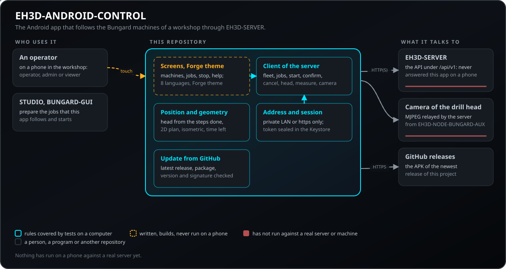
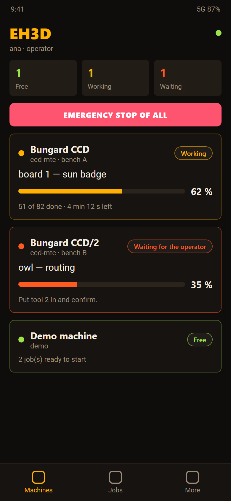
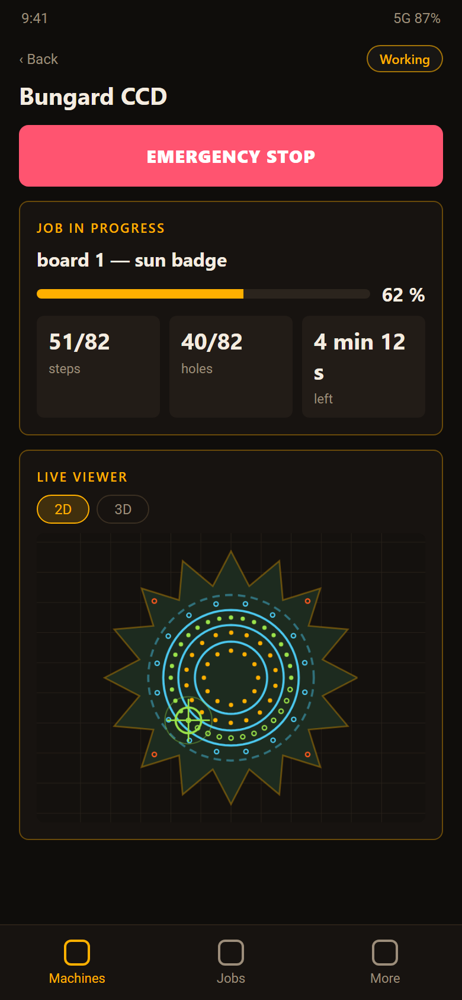
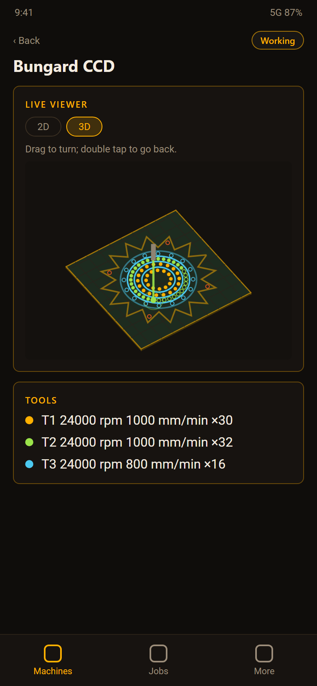
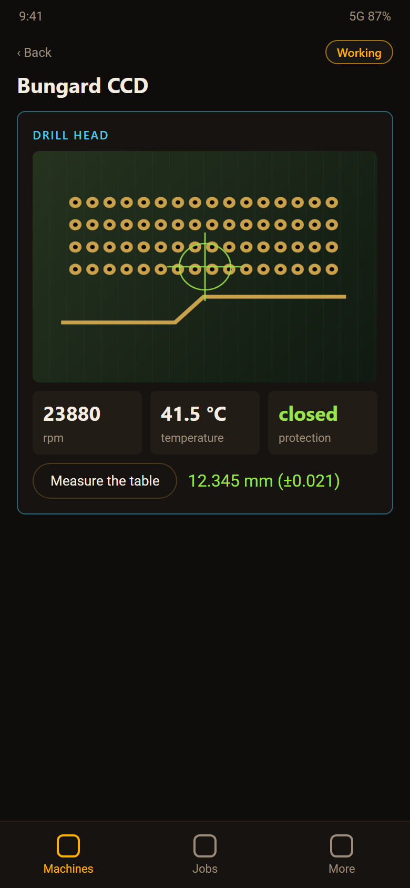
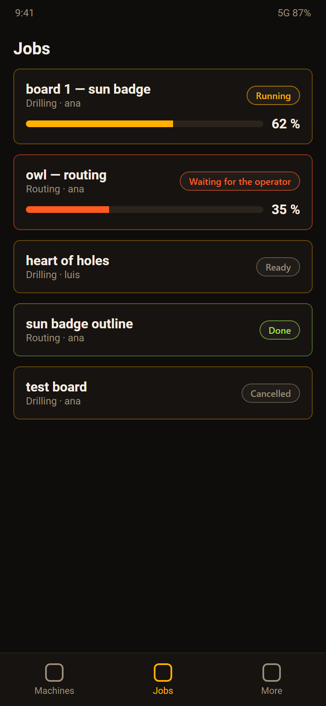
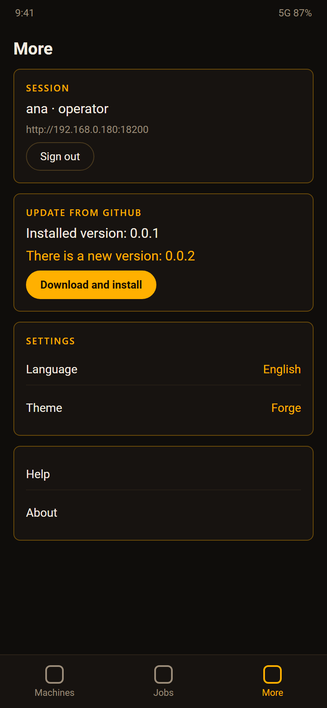
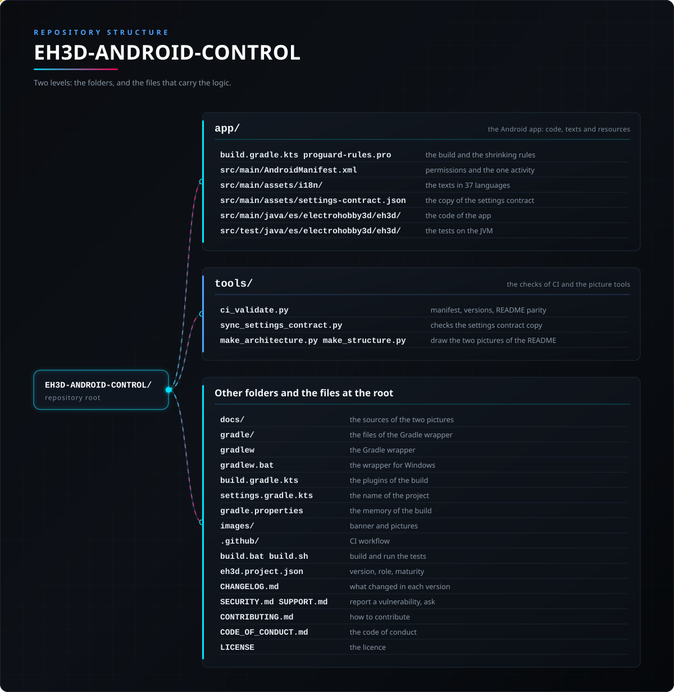

<p align="center">
  
</p>

# 🤖 EH3D-ANDROID-CONTROL

<p align="center"><a href="README.md">🇺🇸 English</a> | 🇪🇸 <b>Español</b> | <a href="README_fra.md">🇫🇷 Français</a> | <a href="README_ita.md">🇮🇹 Italiano</a> | <a href="README_deu.md">🇩🇪 Deutsch</a> | <a href="README_zho.md">🇨🇳 中文</a> | <a href="README_jpn.md">🇯🇵 日本語</a> | <a href="README_por.md">🇵🇹 Português</a></p>

### La app Android de los programas EH3D: sigue en tiempo real las máquinas Bungard del taller a través de EH3D-SERVER, las para, muestra el trabajo en 2D y 3D y la cámara del cabezal de taladrado

<p align="center">
  
  
  
  
  
</p>

---

**Comprobación de honestidad - lo que funciona hoy:** las reglas de la app (leer lo que EH3D-SERVER dice de las máquinas, los trabajos y el cabezal, la posición del cabezal a partir de los pasos hechos, la geometría 2D e isométrica, los idiomas, las comprobaciones de dirección y la conservación de la sesión) están escritas y probadas en un ordenador. Las pantallas están escritas para Android en el tema Forge de los programas EH3D, pero **la app no se ha ejecutado en un teléfono contra un servidor real**, la parada de emergencia nunca ha parado una máquina real y la cámara nunca ha mostrado una placa real.

---

> **Estado de seguridad:** esta app no es un sistema de seguridad y no sustituye a la parada de emergencia de la máquina. Su parada cancela el trabajo en curso a través del servidor, que detiene la máquina y apaga los motores; necesita que la red y el servidor funcionen. Solo los operarios y administradores pueden parar o arrancar; la contraseña solo se envía a una dirección de la red local o por https, y la sesión se guarda cifrada en el teléfono.


## 📋 De un vistazo

| | |
|---|---|
| Versión | `0.1.7` |
| Madurez | Andamiaje |
| Pruebas | 481 pruebas unitarias en la JVM |
| Pila tecnológica | Kotlin, Jetpack Compose |
| En hardware real | Todavía no: la app no se ha ejecutado en un teléfono, contra un servidor real ni con una máquina; lo primero que hay que probar es entrar en el EH3D-SERVER del taller. |

**Ir a:** [Resumen](#-resumen) · [Arquitectura](#-arquitectura) · [Inicio rápido](#-inicio-rápido) · [Pruebas](#-pruebas) · [Estructura](#-estructura-del-repositorio) · [Relacionados](#-proyectos-relacionados)

## 🚦 Estado del proyecto

Cada línea es una parte de este repositorio y la luz dice hasta dónde llega hoy. Se escribe con lo que el repositorio puede demostrar (pruebas, compilaciones, ejecuciones), no con lo previsto.

🟢 Hecho y verificado · 🟡 Funciona, con límites conocidos · 🟠 Hecho a medias o sin verificar · 🔴 Sin hacer o sin funcionar

| Área | Estado | Qué significa aquí |
|---|---|---|
| Software | 🟠 | Las pantallas y las reglas de la app están escritas para Android; las reglas compilan y se prueban sin teléfono. |
| Pruebas | 🟡 | pruebas unitarias en la JVM: lo que dice el servidor de la flota, los trabajos y el cabezal, la posición del cabezal, la geometría 2D e isométrica, los idiomas y las comprobaciones de dirección y versión. |
| Monitorización | 🟠 | Cada máquina del taller con su estado, su trabajo, el progreso, los pasos hechos y el tiempo que queda, leído del servidor cada segundo y medio; un aviso cuando una máquina espera al operario o se detiene. Escrito, no ejecutado contra un servidor real. |
| Conexión | 🟠 | El inicio de sesión se renueva solo en el último cuarto de su vida, se pueden ver y cerrar las sesiones abiertas, las negativas del servidor se dicen en ocho idiomas con la misma tabla que Studio, y el tiempo de espera, los reintentos y una búsqueda opcional del servidor en la red local (apagada por defecto) son ajustes. Escrito y probado contra un servidor simulado; no se ha ejecutado contra uno real ni en un teléfono. |
| Parada de emergencia | 🟠 | Un botón rojo que pregunta dos veces y cancela el trabajo en curso a través del servidor (una máquina o todas); la confirmación de los pasos que espera un trabajo. Solo operarios y administradores. Nunca ha parado una máquina real y no sustituye a su parada física. |
| Preparar trabajos | 🟠 | Elegir taladrado, fresado, ambos o un programa de G-code y el archivo del teléfono; las herramientas del archivo con su recuento (y diámetro si el archivo lo declara), apagar herramientas, empezar por una; pausar, reanudar, cancelar y seguir un trabajo detenido (de cualquier tipo) desde donde se detuvo, con el archivo guardado por el servidor; leer el interruptor de las líneas `$` de GRBL de la máquina. El servidor no tiene lista de archivos, así que el archivo se envía desde el teléfono. Escrito, nunca ejecutado contra un servidor ni una máquina reales. |
| Visor 2D y 3D | 🟠 | La placa, los agujeros (un anillo hasta taladrarlos), las trayectorias (tenues hasta cortarlas) y el cabezal, en 2D y en una vista isométrica que gira con el dedo; la posición del cabezal es una estimación a partir de los pasos hechos. Probado como geometría, nunca visto en un teléfono. |
| Cámara del cabezal | 🟠 | La cámara del cabezal de taladrado (EH3D-NODE-BUNGARD-AUX) en MJPEG a través del servidor, sus vueltas, temperatura y salida de protección, y una medida de la mesa con el láser. Escrito, nunca ejecutado con un nodo real. |
| Actualizaciones | 🟠 | Mira la última release de este proyecto en GitHub, descarga el APK, comprueba el paquete, la versión y la firma y se lo entrega al instalador de Android; nunca instala por sí sola. Escrito y probado; nunca ejecutado contra GitHub desde un teléfono. |
| Máquinas de los plugins | 🟠 | La página de inicio lista las máquinas de láser, pick-and-place, placas, CNC, Gerber, CAM, impresora 3D, visión y CAD del servidor con una insignia SOLO SIMULADOR (nada se muestra como probado en hardware), sus enclavamientos en rojo, una parada de emergencia con un toque y sin preguntas, la liberación de un enclavamiento solo para administradores (con doble confirmación), la cola de cada máquina (cada trabajo muestra un código corto de su hash con una insignia -sin autorizar, autorizado o caducado-; una persona lo autoriza con un segundo toque y lo inicia, con doble confirmación, enviando el código mostrado; nunca solo), los límites de temperatura de una impresora y, para un administrador, los interruptores del servidor que vienen apagados por defecto. Escrito y probado contra un servidor simulado; nunca ejecutado en un teléfono ni con una máquina real. |
| Ajustes del servidor | 🟠 | Una página en Más dibuja cada ajuste e interruptor del servidor desde su contrato (100 claves en 17 grupos; se lee del servidor y, si no se puede, de la copia guardada en la app, en solo lectura): etiqueta, ayuda y aviso en ocho idiomas, el valor en vigor, el valor por defecto con un botón para restaurarlo, si el cambio se aplica ya o necesita reinicio y el control de su tipo. Cualquier otro usuario (visor, operador) lee la vista ligera de los valores en vigor (`GET /settings/values`, con ETag para que una página sin cambios cueste unos pocos bytes) con las etiquetas de la copia, en solo lectura, y se le avisa cuando la lista de ajustes del servidor no es la copia de la app; una clave que el servidor no muestra se marca como tal. Un administrador cambia las 19 claves que el servidor cambia en marcha y se le pregunta una segunda vez en las de riesgo; las otras 81 se muestran con la nota de que se fijan en server.cfg; un secreto nunca se muestra. Escrito y probado contra un servidor simulado; nunca ejecutado contra uno real. |
| Nodos pick-and-place | 🟠 | La pantalla de inicio lista, solo en lectura, los nodos de alimentadores y de cabezal de las máquinas pick-and-place que guarda el servidor: tipo, dirección y máquina, listo (verde) o no (rojo) según lo cuenta el servidor, la salud que informa, el último error de su consulta y los números que dijo por última vez; el token nunca se lee ni se muestra, y los nodos se registran y se cambian en EH3D-STUDIO. Escrito y probado contra un servidor simulado; nunca ejecutado con un alimentador, un cabezal ni un servidor reales. |
| Impresoras 3D | 🟠 | La página de inicio lista, solo en lectura, las impresoras 3D que vigila el servidor: salud, estado, temperaturas, progreso, tiempo restante, capa y alertas; lo que una impresora no ha dicho se muestra como desconocido, nunca como cero, no se muestra nada mientras el servidor tenga la lista apagada y no se puede enviar nada a una impresora (el código de acceso nunca se lee). Escrito y probado contra respuestas simuladas; nunca ejecutado contra una impresora, un servidor o un teléfono reales. |
| Uso real | 🔴 | Todavía no: la app no se ha ejecutado en un teléfono, contra un servidor real ni con una máquina; lo primero que hay que probar es entrar en el EH3D-SERVER del taller. |
| Documentación | 🟡 | README en ocho idiomas, la ayuda de la app en 8 idiomas y las notas de la API del servidor que usa. |

## 🎯 Resumen

* Cada máquina del taller con su estado, su trabajo, el progreso, los pasos hechos y el tiempo que queda, leído del servidor cada segundo y medio; un aviso cuando una máquina espera al operario o se detiene. Escrito, no ejecutado contra un servidor real.
* Un botón rojo que pregunta dos veces y cancela el trabajo en curso a través del servidor (una máquina o todas); la confirmación de los pasos que espera un trabajo. Solo operarios y administradores. Nunca ha parado una máquina real y no sustituye a su parada física.
* Empezar un trabajo desde su página pide una confirmación más (compruebe que la máquina está preparada y despejada), igual que desde Preparar, para que un toque por error no ponga la máquina en marcha.
* Antes de empezar un trabajo, un resumen muestra qué hace, cuánto tarda, hasta dónde llega cada eje (la simulación en seco del plan exacto que hizo el servidor) y qué parece mal, con Empezar y Cancelar; un ajuste lo apaga (activado por defecto). Escrito, nunca probado con un servidor real.
* La conexión se cuenta con honestidad: conectado, datos que envejecen (con su edad), sin conexión tras dos fallos seguidos, o una dirección que responde otro servicio, con un botón para reintentar; al pulsar PARAR sin conexión avisa de que la orden puede no llegar y de que se use la parada física de la máquina, y tras una parada la app dice si la máquina la confirmó. Escrito, nunca probado con un servidor real.
* Elegir taladrado, fresado, ambos o un programa de G-code y el archivo del teléfono; las herramientas del archivo con su recuento (y diámetro si el archivo lo declara), apagar herramientas, empezar por una; pausar, reanudar, cancelar y seguir un trabajo detenido (de cualquier tipo) desde donde se detuvo, con el archivo guardado por el servidor; leer el interruptor de las líneas `$` de GRBL de la máquina. El servidor no tiene lista de archivos, así que el archivo se envía desde el teléfono. Escrito, nunca ejecutado contra un servidor ni una máquina reales.
* La placa, los agujeros (un anillo hasta taladrarlos), las trayectorias (tenues hasta cortarlas) y el cabezal, en 2D y en una vista isométrica que gira con el dedo; la posición del cabezal es una estimación a partir de los pasos hechos. Probado como geometría, nunca visto en un teléfono.
* La cámara del cabezal de taladrado (EH3D-NODE-BUNGARD-AUX) en MJPEG a través del servidor, sus vueltas, temperatura y salida de protección, y una medida de la mesa con el láser. Escrito, nunca ejecutado con un nodo real.
* Mira la última release de este proyecto en GitHub, descarga el APK, comprueba el paquete, la versión y la firma y se lo entrega al instalador de Android; nunca instala por sí sola. Escrito y probado; nunca ejecutado contra GitHub desde un teléfono.
* Una página en Más dibuja cada ajuste e interruptor del servidor desde su contrato (100 claves en 17 grupos; se lee del servidor y, si no se puede, de la copia guardada en la app, en solo lectura): etiqueta, ayuda y aviso en ocho idiomas, el valor en vigor, el valor por defecto con un botón para restaurarlo, si el cambio se aplica ya o necesita reinicio y el control de su tipo. Un administrador cambia las 19 claves que el servidor cambia en marcha y se le pregunta una segunda vez en las de riesgo; las otras 81 se muestran con la nota de que se fijan en server.cfg; un secreto nunca se muestra. Escrito y probado contra un servidor simulado; nunca ejecutado contra uno real.
* La pantalla de inicio lista, solo en lectura, los nodos de alimentadores y de cabezal de las máquinas pick-and-place que guarda el servidor: tipo, dirección y máquina, listo (verde) o no (rojo) según lo cuenta el servidor, la salud que informa, el último error de su consulta y los números que dijo por última vez; el token nunca se lee ni se muestra, y los nodos se registran y se cambian en EH3D-STUDIO. Escrito y probado contra un servidor simulado; nunca ejecutado con un alimentador, un cabezal ni un servidor reales.
* La página de inicio lista, solo en lectura, las impresoras 3D que vigila el servidor: salud, estado, temperaturas, progreso, tiempo restante, capa y alertas; lo que una impresora no ha dicho se muestra como desconocido, nunca como cero, no se muestra nada mientras el servidor tenga la lista apagada y no se puede enviar nada a una impresora (el código de acceso nunca se lee). Escrito y probado contra respuestas simuladas; nunca ejecutado contra una impresora, un servidor o un teléfono reales.

La página de una máquina también tiene el aro de LEDs del cabezal (apagado y tres niveles) y una tarjeta Verificación de calidad: pide al servidor que mire la placa con la cámara del cabezal de taladro, juzga los agujeros y los canales fresados y muestra el veredicto grande como un cartel (CORRECTO, NO CORRECTO o no se puede juzgar) con lo que se encontró, el perfil (estándar, paso fino, prototipo) y la calibración de la escala. Las primeras pantallas (la de inicio con la marca, la espera mientras se restaura la sesión y la de entrada con sus iconos, el ojo para la contraseña y la nota sobre lo que se guarda en el teléfono) siguen el aspecto de las otras apps de la suite.

La página de una máquina también muestra el husillo de la máquina (el original o el que lleva variador de frecuencia), con sus límites y la velocidad máxima a la que debe ajustarse el nodo; un administrador lo elige y elige qué hace el servidor con un trabajo que pide más (rechazarlo, o dejarlo pasar recortado al máximo del husillo). Un trabajo muestra los excesos con que se dejó pasar, las herramientas que se desactivaron para él y los agujeros o trayectos ya hechos que deja fuera. La página de una máquina libre tiene además Preparar trabajo: se elige qué se hace (taladrado, fresado, ambos o un programa de G-code libre) y el archivo del teléfono; el servidor lo planea, y la app lista las herramientas del archivo con su recuento, deja apagar herramientas o empezar por una (las anteriores en el orden del trabajo quedan fuera) y arranca el trabajo tras una confirmación. Con ambos se crean dos trabajos y el segundo queda listo. Un programa de G-code se puede pausar, reanudar, cancelar y continuar desde la línea donde se detuvo; el husillo y el refrigerante solo se vuelven a encender si se activa esa opción (desactivada por defecto).

La tarjeta del cabezal muestra también lo que dicen sus sensores: cómo fue la última lectura del láser (válida, señal débil, demasiada dispersión, fuera de rango, fallo del sensor) con la distancia, hace cuánto se tomó y el desfase con el que se calibró el láser; si los pulsos del sensor de giro son limpios o ruidosos y cuántos se descartaron como ruido; cuántos sensores de temperatura encontró el nodo en el hilo (y un aviso cuando solo adivina cuál leer); y la versión del nodo. Un nodo que no lo dice no muestra nada de esto. Los ajustes de la imagen de la cámara, la calibración del láser y la elección del sensor de temperatura se hacen en el panel del nodo: el servidor todavía no los transmite.

## 🧩 Papel en EH3D

EH3D-ANDROID-CONTROL es la pantalla de bolsillo del taller EH3D: solo habla con EH3D-SERVER, que ejecuta los trabajos en las máquinas (a través de EH3D-NODE-BUNGARD) y retransmite la cámara del cabezal de taladrado (EH3D-NODE-BUNGARD-AUX). Los trabajos se preparan en EH3D-STUDIO, BUNGARD-GUI o en esta app con Preparar trabajo; esta app los sigue, confirma los pasos que esperan y los para.

## 🏛️ Arquitectura

<p align="center">
  
</p>

Cómo encajan las partes de este repositorio: quién lo usa, qué contiene y de qué depende. La imagen se dibuja desde `docs/architecture.json` y se comprueba contra el código.

## 🖼️ Capturas de pantalla

<p align="center">
  
</p>

<p align="center"><em>Las máquinas del taller: libres, trabajando y esperando al operario, con la parada de todas.</em></p>

<p align="center">
  
</p>

<p align="center"><em>Una máquina: la parada, el trabajo en curso y la vista 2D en directo con la posición del cabezal.</em></p>

<p align="center">
  
</p>

<p align="center"><em>La vista isométrica del mismo trabajo, girada con el dedo, y sus herramientas.</em></p>

<p align="center">
  
</p>

<p align="center"><em>El cabezal de taladrado: la cámara a través del servidor, las vueltas, la temperatura, la salida de protección y la medida de la mesa.</em></p>

<p align="center">
  
</p>

<p align="center"><em>Los trabajos del servidor con sus estados.</em></p>

<p align="center">
  
</p>

<p align="center"><em>Más: la sesión, la actualización desde GitHub, el idioma y la ayuda.</em></p>

<p align="center"><em>Un dibujo de las pantallas hecho con las mismas reglas y un trabajo de ejemplo, no una captura de un teléfono: la app no se ha ejecutado en uno.</em></p>

## 🚀 Inicio rápido

Necesita JDK 21 y el SDK de Android (el wrapper de Gradle hace el resto) y un EH3D-SERVER en la red.

```bash
build.bat          # tests and debug APK (Windows)  -  ./build.sh on Linux
test.bat           # only the tests
python -I tools/ci_validate.py
```

Abra la app, escriba la dirección del servidor (y el puerto 18200), pulse Conectar e inicie sesión. Un servidor sin usuarios pide el código de alta que muestra en su consola y crea el primer administrador.

## 🧪 Pruebas

`./gradlew test` ejecuta las pruebas unitarias en la JVM: los lectores del JSON del servidor (flota, trabajos, cabezal, medida), la posición del cabezal y la geometría de las dos vistas, la comprobación de la dirección, la conservación cifrada de la sesión, la versión y la puerta de la release de la actualización, y los idiomas (cada frase del código en las siete tablas, con los mismos huecos). También leen los ejemplos de respuestas que hacen las pruebas del servidor, de modo que una respuesta que cambia sin que la app la siga falla aquí. Las dos apps móviles recorren además los mismos ficheros de casos (el resumen, la conexión, la parada, los avisos, las direcciones y los campos que leen), así que una no puede diferir de la otra sin que falle un test. `python -I tools/check_app_parity.py` comprueba que los ejemplos de las respuestas, el catálogo de rechazos y las tablas de los 8 idiomas son los mismos en las dos apps de móvil (la única frase del certificado fijado es la única diferencia permitida), y el CI imprime cuánto del código que guarda reglas cubren estas pruebas. `python -I tools/sync_settings_contract.py --check` comprueba que la copia del contrato de ajustes del servidor (y la tabla de las frases de su página) es válida y, con EH3D-SERVER junto a este repositorio, que es el mismo fichero que el del servidor; `check_app_parity.py` comprueba además que las dos apps llevan la misma copia y la misma tabla. La misma comprobación escribe en `ContractHash.kt` el SHA-256 de la copia y lo verifica, y la app lo compara con el `contract_hash` que da el servidor para poder avisar cuando la lista de ajustes del servidor no es su copia. Respuestas simuladas y hostiles de la lista de impresoras 3D (`printer_cases.json`, compartido por las dos apps) comprueban que lo desconocido sigue siendo desconocido, que una lista apagada no muestra nada y que la app no tiene ninguna petición que pueda enviar algo a una impresora.

## 🏗️ Compilación y publicación

La versión vive en `eh3d.project.json` y en `app/build.gradle.kts` (la compilación se detiene si difieren) y cada versión tiene su entrada en [CHANGELOG.md](CHANGELOG.md). El APK de la release se reduce con R8 y se firma después con la clave propia del mantenedor, guardada fuera del repositorio; el archivo de una release es `EH3D-ANDROID-CONTROL-release.apk`, el que busca la actualización desde GitHub.

## 📂 Estructura del repositorio

<p align="center">
  
</p>

<details>
<summary>Versión en texto del árbol</summary>

```text
EH3D-ANDROID-CONTROL/
├── app/
│   ├── build.gradle.kts proguard-rules.pro      la compilación y las reglas de reducción
│   ├── src/main/AndroidManifest.xml             permisos y la única actividad
│   ├── src/main/assets/i18n/                    los textos en 8 idiomas
│   ├── src/main/assets/settings-contract.json   la copia del contrato de ajustes
│   ├── src/main/java/es/electrohobby3d/eh3d/    el código de la app
│   └── src/test/java/es/electrohobby3d/eh3d/    las pruebas en la JVM
├── tools/
│   ├── ci_validate.py                           manifiesto, versiones, paridad de README
│   ├── sync_settings_contract.py                comprueba la copia del contrato
│   └── make_architecture.py make_structure.py   dibujan las dos imágenes del README
├── docs/                                        las fuentes de las dos imágenes
├── gradle/                                      los archivos del wrapper de Gradle
├── gradlew                                      el wrapper de Gradle
├── gradlew.bat                                  el wrapper para Windows
├── build.gradle.kts                             los complementos de la compilación
├── settings.gradle.kts                          el nombre del proyecto
├── gradle.properties                            la memoria de la compilación
├── images/                                      banner e imágenes
├── .github/                                     flujo de CI
├── build.bat build.sh                           compilar y ejecutar las pruebas
├── eh3d.project.json                            versión, rol, madurez
├── CHANGELOG.md                                 qué cambió en cada versión
├── SECURITY.md SUPPORT.md                       informar de una vulnerabilidad, preguntar
├── CONTRIBUTING.md                              cómo contribuir
├── CODE_OF_CONDUCT.md                           el código de conducta
└── LICENSE                                      la licencia
```

</details>

## 🗺️ Hoja de ruta y límites conocidos

**Límites conocidos hoy**

* La app no se ha ejecutado en un teléfono, contra un servidor real ni con una máquina.
* La posición del cabezal es una estimación a partir de los pasos hechos; el servidor no informa de la posición real de la máquina.
* La parada de emergencia pasa por el servidor y la red: no es una parada física.
* La cámara nunca ha mostrado una imagen real y la medida de la mesa nunca se ha tomado con un láser real.

**Siguiente**

* Entrar en el EH3D-SERVER del taller y seguir un trabajo real.
* Mostrar la posición real del cabezal cuando el servidor la informe.
* Los avisos con la app cerrada vienen de una tarea periódica (cada 15 minutos como mucho, lo mínimo que permite Android), no en tiempo real; un canal push del servidor los haría inmediatos y aún no existe.
* Elegir el archivo entre los guardados en el servidor en vez de en el teléfono (el servidor aún no tiene lista de archivos).

## 🌍 Idiomas

El README existe en inglés, español, francés, italiano, alemán, chino, japonés y portugués de Portugal. La propia app habla esos mismos ocho idiomas (los de los programas EH3D del ordenador); una frase que un idioma no tiene se muestra en inglés.

| Código | Idioma | Código | Idioma | Código | Idioma | Código | Idioma |
|---|---|---|---|---|---|---|---|
| `en` | English | `es` | Español | `it` | Italiano | `de` | Deutsch |
| `fr` | Français | `pt` | Português | `zh` | 中文 | `ja` | 日本語 |

## 🔗 Proyectos relacionados

* [EH3D-SERVER](https://github.com/JuanenRac/EH3D-SERVER): el centro de la familia EH3D: ejecuta los trabajos en las máquinas y da a esta app todo lo que muestra
* [EH3D-STUDIO](https://github.com/JuanenRac/EH3D-STUDIO): las páginas donde se añaden las máquinas y se preparan los trabajos
* [EH3D-BUNGARD-GUI](https://github.com/JuanenRac/EH3D-BUNGARD-GUI): el programa del ordenador que prepara los trabajos de taladrado y fresado y los ejecuta
* [EH3D-NODE-BUNGARD-AUX](https://github.com/JuanenRac/EH3D-NODE-BUNGARD-AUX): el nodo del cabezal de taladrado: la cámara, el láser y los sensores que muestra esta app
* [EH3D-IOS-CONTROL](https://github.com/JuanenRac/EH3D-IOS-CONTROL): las apps de Android y de iPhone son gemelas: las mismas reglas y las mismas pantallas

## 📚 Documentación

* [La API del servidor](https://github.com/JuanenRac/EH3D-SERVER/blob/main/docs/API.md): lo que esta app lee y pide.
* [Diferencias entre las apps de Android y de iPhone](docs/PLATFORM_DIFFERENCES.md): lo que el sistema obliga a que sea distinto.
* [Registro de cambios](CHANGELOG.md)

## 🤝 Contribuir y comunidad

* Antes de un pull request ejecute `./gradlew test` y `python -I tools/ci_validate.py`: ambos deben pasar. Vea [CONTRIBUTING.md](CONTRIBUTING.md) y el [código de conducta](CODE_OF_CONDUCT.md).
* Cada texto que muestra la app está en las tablas de `app/src/main/assets/i18n` en los 8 idiomas; una prueba las mantiene completas.
* Informe de una vulnerabilidad en privado: [SECURITY.md](SECURITY.md). Preguntas, ideas e informes: electrohobby3d@gmail.com ([SUPPORT.md](SUPPORT.md)).

## 👤 AUTOR

**JuanenRac (Electro Hobby 3D)** · electrohobby3d@gmail.com

## 📜 LICENCIA

Software: GPL-3.0-or-later. Véase [LICENSE](LICENSE). Los diseños de hardware de la suite usan CERN OHL-S.
