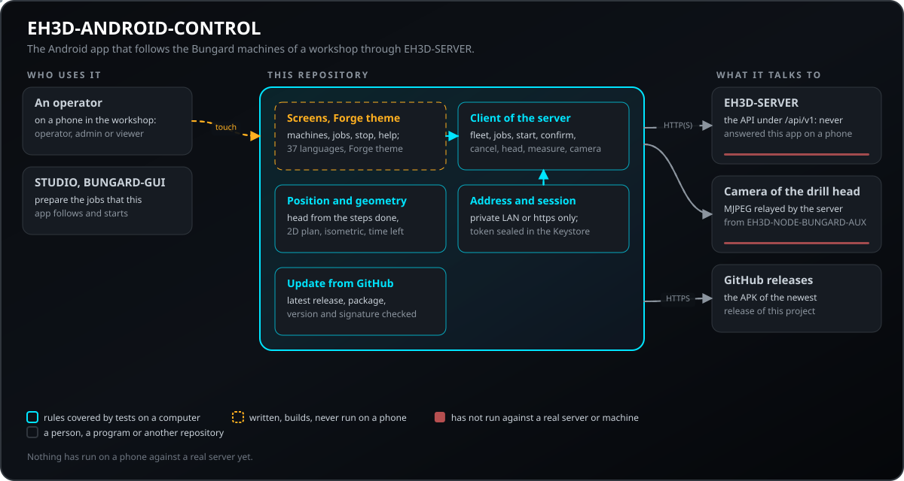
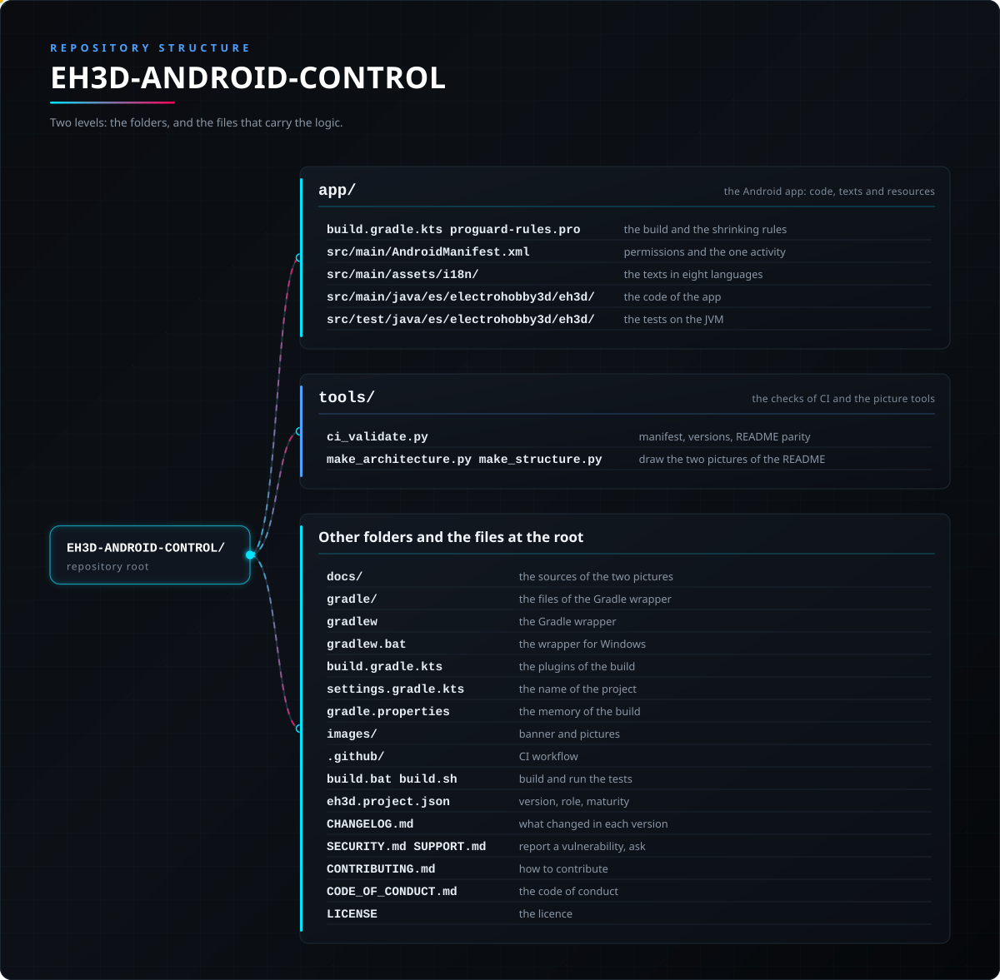

<p align="center">
  
</p>

# 🤖 EH3D-ANDROID-CONTROL

<p align="center"><a href="README.md">🇺🇸 English</a> | <a href="README_spa.md">🇪🇸 Español</a> | <a href="README_fra.md">🇫🇷 Français</a> | <a href="README_ita.md">🇮🇹 Italiano</a> | <a href="README_deu.md">🇩🇪 Deutsch</a> | 🇨🇳 <b>中文</b> | <a href="README_jpn.md">🇯🇵 日本語</a> | <a href="README_por.md">🇵🇹 Português</a></p>

### EH3D 程序的 Android 应用：通过 EH3D-SERVER 实时跟踪车间的 Bungard 机器，可停止它们，以 2D 和 3D 显示作业，并显示钻孔头的摄像头

<p align="center">
  
  
  
  
  
</p>

---

**诚实声明——今天真正能运行的部分：** 应用的规则（读取 EH3D-SERVER 关于机器、作业和钻头的数据，根据已完成步数推算钻头位置，2D 与等距几何，语言，地址检查和会话保存）已编写并在电脑上测试。界面按 EH3D 程序的 Forge 主题为 Android 编写，但**该应用从未在 手机 上对真实服务器运行过**，紧急停止从未停过真实机器，摄像头也从未显示过真实的板子。

---

> **安全状态：** 本应用不是安全系统，不能代替机器的急停。它的停止通过服务器取消正在运行的作业，由服务器停止机器并关闭驱动；需要网络和服务器正常工作。只有操作员和管理员可以停止或启动；密码仅发送到本地网络地址或通过 https，会话以加密方式保存在手机上。


## 📋 速览

| | |
|---|---|
| 版本 | `0.0.2` |
| 成熟度 | 脚手架 |
| 测试 | JVM 上的单元测试 |
| 技术栈 | Kotlin, Jetpack Compose |
| 真实硬件 | 还没有：应用从未在 手机 上、对真实服务器或与机器一起运行；首先要试的是登录车间的 EH3D-SERVER。 |

**跳转到：** [概述](#-概述) · [架构](#-架构) · [快速开始](#-快速开始) · [测试](#-测试) · [结构](#-仓库结构) · [相关项目](#-相关项目)

## 🚦 项目状态

每一行是本仓库的一个部分，灯号表示它今天做到了哪一步。内容依据仓库能够展示的证据（测试、构建、运行），而不是计划。

🟢 已完成并验证 · 🟡 可用，有已知限制 · 🟠 部分完成或尚未验证 · 🔴 未完成或不可用

| 领域 | 状态 | 在这里的含义 |
|---|---|---|
| 软件 | 🟠 | 界面和应用规则按 Android 编写；规则无需手机即可构建和测试。 |
| 测试 | 🟡 | JVM 上的单元测试：服务器返回的机器群、作业和钻头数据，钻头位置，2D 与等距几何，语言，以及地址和版本检查。 |
| 监控 | 🟠 | 车间里每台机器的状态、作业、进度、已完成步数和剩余时间，每 1.5 秒从服务器读取；机器等待操作员或停止时发出通知。已编写，未对真实服务器运行。 |
| 紧急停止 | 🟠 | 一个需要确认两次的红色按钮，通过服务器取消正在运行的作业（单台或全部）；以及对作业所等待步骤的确认。仅限操作员和管理员。它从未停过真实机器，也不能代替其物理急停。 |
| 2D 和 3D 查看器 | 🟠 | 板子、孔（钻孔前为圆环）、路径（切削前为淡色）和钻头，以 2D 和可用手指旋转的等距视图显示；钻头位置是根据已完成步数得出的估计。作为几何已测试，从未在手机上看过。 |
| 钻头摄像头 | 🟠 | 钻孔头（EH3D-NODE-BUNGARD-AUX）的摄像头通过服务器以 MJPEG 显示，并显示转速、温度、保护输出，以及用激光测量一次工作台。已编写，从未与真实节点一起运行。 |
| 更新 | 🟠 | 它查看本项目在 GitHub 上的最新发布，下载 APK，检查包名、版本和签名，然后交给 Android 安装程序；它绝不会自行安装。已编写并测试；从未在手机上对 GitHub 运行过。 |
| 实际使用 | 🔴 | 还没有：应用从未在 手机 上、对真实服务器或与机器一起运行；首先要试的是登录车间的 EH3D-SERVER。 |
| 文档 | 🟡 | 八种语言的 README、应用内八种语言的帮助，以及所用服务器 API 的说明。 |

## 🎯 概述

* 车间里每台机器的状态、作业、进度、已完成步数和剩余时间，每 1.5 秒从服务器读取；机器等待操作员或停止时发出通知。已编写，未对真实服务器运行。
* 一个需要确认两次的红色按钮，通过服务器取消正在运行的作业（单台或全部）；以及对作业所等待步骤的确认。仅限操作员和管理员。它从未停过真实机器，也不能代替其物理急停。
* 板子、孔（钻孔前为圆环）、路径（切削前为淡色）和钻头，以 2D 和可用手指旋转的等距视图显示；钻头位置是根据已完成步数得出的估计。作为几何已测试，从未在手机上看过。
* 钻孔头（EH3D-NODE-BUNGARD-AUX）的摄像头通过服务器以 MJPEG 显示，并显示转速、温度、保护输出，以及用激光测量一次工作台。已编写，从未与真实节点一起运行。
* 它查看本项目在 GitHub 上的最新发布，下载 APK，检查包名、版本和签名，然后交给 Android 安装程序；它绝不会自行安装。已编写并测试；从未在手机上对 GitHub 运行过。

机床页面还包含钻头的 LED 环形灯（关和三档亮度）以及“质量检查”卡片：它请服务器通过钻头摄像头查看电路板，判断孔和铣削沟槽，并以招牌大小显示结论（合格、不合格或无法判定），同时显示发现的问题、配置（标准、细间距、原型）和比例校准。最初的几个界面（带标志的启动页、恢复会话时的等待页，以及带图标、密码可见开关和手机上保存内容说明的登录页）沿用套件中其他应用的外观。

机床页面还显示机器的主轴（原装主轴或带变频器的主轴）、它的限值以及节点应设置的最高转速；管理员可以选择主轴，并选择服务器如何处理要求超出能力的作业（拒绝，或降到主轴上限后放行）。作业会列出放行时的超限项、为它关闭的刀具，以及它略过的已完成的孔或路径。本应用不创建作业，因此选择钻孔、铣削或两者并关闭刀具仍在 EH3D-STUDIO 和 BUNGARD-GUI 中完成。

## 🧩 在 EH3D 中的角色

EH3D-ANDROID-CONTROL 是 EH3D 车间的口袋屏幕：它只与 EH3D-SERVER 通信，由服务器（经 EH3D-NODE-BUNGARD）在机器上执行作业，并转发钻孔头（EH3D-NODE-BUNGARD-AUX）的摄像头。作业在 EH3D-STUDIO 或 BUNGARD-GUI 中准备；本应用跟踪它们、确认它们所等待的步骤并停止它们。

## 🏛️ 架构

<p align="center">
  
</p>

本仓库各部分如何协作：谁在使用它、它包含什么、它依赖什么。图片由 `docs/architecture.json` 绘制，并与代码核对。

## 🖼️ 屏幕截图

<p align="center">
  
</p>

<p align="center"><em>车间的机器：空闲、工作中和等待操作员，以及全部停止按钮。</em></p>

<p align="center">
  
</p>

<p align="center"><em>单台机器：停止按钮、进行中的作业以及显示钻头位置的实时 2D 视图。</em></p>

<p align="center">
  
</p>

<p align="center"><em>同一作业的等距视图（可用手指旋转）及其刀具。</em></p>

<p align="center">
  
</p>

<p align="center"><em>钻孔头：经服务器的摄像头、转速、温度、保护输出和工作台测量。</em></p>

<p align="center">
  
</p>

<p align="center"><em>服务器的作业及其状态。</em></p>

<p align="center">
  
</p>

<p align="center"><em>更多：会话、从 GitHub 更新、语言和帮助。</em></p>

<p align="center"><em>用相同规则和示例作业绘制的界面图，不是手机截图：应用从未在手机上运行。</em></p>

## 🚀 快速开始

需要 JDK 21 和 Android SDK（其余由 Gradle 包装器完成），以及网络上的 EH3D-SERVER。

```bash
build.bat          # tests and debug APK (Windows)  -  ./build.sh on Linux
test.bat           # only the tests
python -I tools/ci_validate.py
```

打开应用，输入服务器地址（和端口 18200），点“连接”并登录。没有用户的服务器会要求输入其控制台显示的初始化代码，并创建第一个管理员。

## 🧪 测试

`./gradlew test` 在 JVM 上运行单元测试：服务器 JSON 的读取（机器群、作业、钻头、测量）、钻头位置和两个视图的几何、地址检查、会话的加密保存、更新的版本与发布检查，以及语言（源码中的每个短语都在七张表中，占位符相同）。

## 🏗️ 构建与发布

版本记录在 `eh3d.project.json` 和 `app/build.gradle.kts` 中（两者不一致时构建会停止），每个版本在 [CHANGELOG.md](CHANGELOG.md) 中都有条目。发布版 APK 用 R8 压缩，之后用保存在仓库之外的维护者自己的密钥签名；发布的文件是 `EH3D-ANDROID-CONTROL-release.apk`，即从 GitHub 更新所查找的文件。

## 📂 仓库结构

<p align="center">
  
</p>

<details>
<summary>目录树的文本版</summary>

```text
EH3D-ANDROID-CONTROL/
├── app/
│   ├── build.gradle.kts proguard-rules.pro      构建与压缩规则
│   ├── src/main/AndroidManifest.xml             权限和唯一的活动
│   ├── src/main/assets/i18n/                    八种语言的文本
│   ├── src/main/java/es/electrohobby3d/eh3d/    应用代码
│   └── src/test/java/es/electrohobby3d/eh3d/    JVM 上的测试
├── tools/
│   ├── ci_validate.py                           清单、版本、README 一致性
│   └── make_architecture.py make_structure.py   绘制 README 的两张图
├── docs/                                        两张图的源文件
├── gradle/                                      Gradle 包装器文件
├── gradlew                                      Gradle 包装器
├── gradlew.bat                                  Windows 包装器
├── build.gradle.kts                             构建插件
├── settings.gradle.kts                          项目名称
├── gradle.properties                            构建内存
├── images/                                      横幅和图片
├── .github/                                     CI 工作流
├── build.bat build.sh                           构建并运行测试
├── eh3d.project.json                            版本、角色、成熟度
├── CHANGELOG.md                                 每个版本的变化
├── SECURITY.md SUPPORT.md                       报告漏洞、提问
├── CONTRIBUTING.md                              如何贡献
├── CODE_OF_CONDUCT.md                           行为准则
└── LICENSE                                      许可证
```

</details>

## 🗺️ 路线图与已知限制

**目前已知的限制**

* 应用从未在 手机 上、对真实服务器或与机器一起运行。
* 钻头位置是根据已完成步数得出的估计；服务器不会报告机器的真实位置。
* 紧急停止经过服务器和网络：它不是物理急停。
* 摄像头从未显示过真实画面，工作台测量也从未用真实激光进行过。

**下一步**

* 登录车间的 EH3D-SERVER 并跟踪一个真实作业。
* 服务器报告真实位置后，显示钻头的真实位置。
* 应用关闭时也能通知（服务器的推送通道）。
* 一个可在手机上准备并启动作业的页面。

## 🌍 语言

README 和文本提供英语、西班牙语、法语、意大利语、德语、汉语、日语和欧洲葡萄牙语版本。

## 🔗 相关项目

* [EH3D-SERVER](https://github.com/JuanenRac/EH3D-SERVER): EH3D 家族的中心：在机器上执行作业，并向本应用提供其显示的所有内容
* [EH3D-STUDIO](https://github.com/JuanenRac/EH3D-STUDIO): 添加机器和准备作业的页面
* [EH3D-BUNGARD-GUI](https://github.com/JuanenRac/EH3D-BUNGARD-GUI): 在电脑上准备并执行钻孔和铣削作业的程序
* [EH3D-NODE-BUNGARD-AUX](https://github.com/JuanenRac/EH3D-NODE-BUNGARD-AUX): 钻孔头节点：本应用显示的摄像头、激光和传感器
* [EH3D-IOS-CONTROL](https://github.com/JuanenRac/EH3D-IOS-CONTROL): Android 和 iPhone 应用是孪生的：规则和界面相同

## 📚 文档

* [服务器 API](https://github.com/JuanenRac/EH3D-SERVER/blob/main/docs/API.md)：本应用读取和请求的内容。
* [更新日志](CHANGELOG.md)

## 🤝 参与贡献与社区

* 提交拉取请求之前请运行 `./gradlew test` 和 `python -I tools/ci_validate.py`：两者都必须通过。参见 [CONTRIBUTING.md](CONTRIBUTING.md) 和[行为准则](CODE_OF_CONDUCT.md)。
* 应用显示的每段文字都在 `app/src/main/assets/i18n` 的表中，包含八种语言；测试保证其完整。
* 请私下报告漏洞：[SECURITY.md](SECURITY.md)。问题、想法和报告：electrohobby3d@gmail.com（[SUPPORT.md](SUPPORT.md)）。

## 👤 作者

**JuanenRac (Electro Hobby 3D)** · electrohobby3d@gmail.com

## 📜 许可证

软件：GPL-3.0-or-later。见 [LICENSE](LICENSE)。套件的硬件设计使用 CERN OHL-S。
